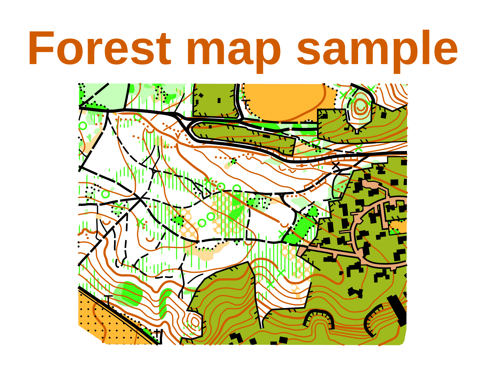
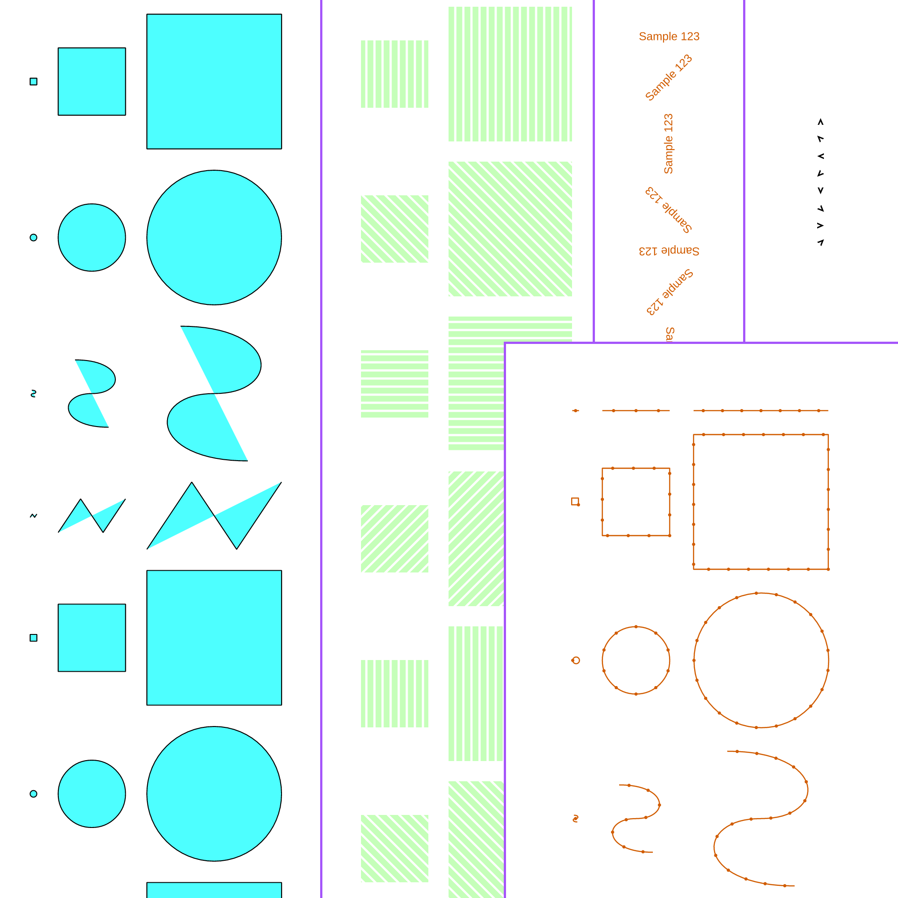
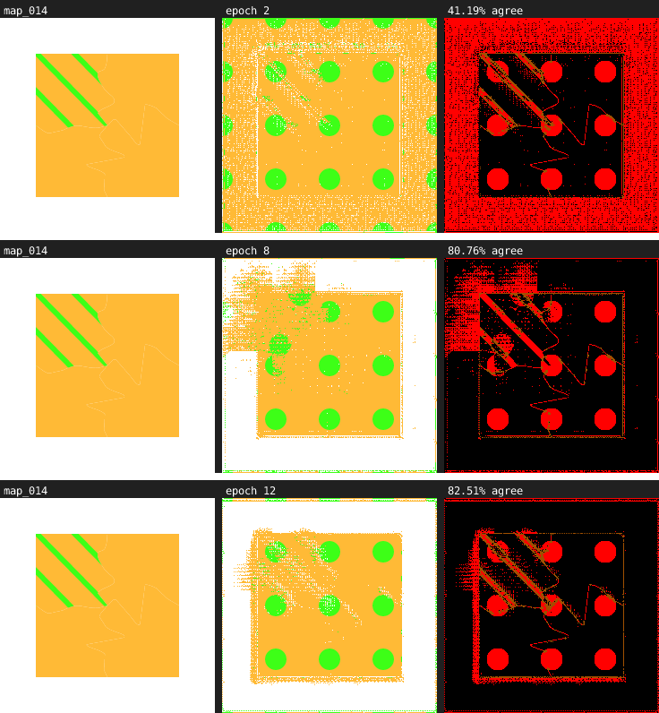

# MaUR-O

[][crate]
[](https://github.com/Noce99/MaUR-O/actions/workflows/ci.yml)

This is a **Ma**p **U**tils project written in **R**ust for **O**rienteering.


*The ground-truth renderer's output (left) side by side with MaUR-O's own rendering of the same map (right). Map: Valserena, owned by [Polisportiva Masi](https://www.polmasi.it/attivita_sportive/palestra/orienteering.it.html) and made by [Samuele Curzio](https://mapsamthing.com/en/) and [Remo Madella](https://www.remmaps.it/).*

It renders [OpenOrienteering Mapper](https://www.openorienteering.org/apps/mapper/)
`.omap`/`.xmap` files to raster images (PNG, BMP, TIFF, JPEG) from the command
line, without needing Mapper itself, Qt, or a graphical environment installed.
OCAD `.ocd` files — versions 6 through 12 and 2018 — are read too, converted
to Mapper's format on the way in, so the same tools work on either.
Alongside the renderer, it ships a small pair of benchmarking tools that build
and run suites of maps to measure how closely the renderer's output matches a
ground-truth reference — useful both for tracking rendering fidelity over time
and for spotting real regressions among the noise two rasterizers naturally
disagree on — and a generator that makes random maps out of an existing symbol
set, for when the maps that exist are not enough.

It also ships tools that go beyond drawing a map:

- **`mauro dem`** reconstructs an elevation model (a GeoTIFF) from a
  map's contour lines, and **`mauro dem-eval`** scores such a model
  against a ground-truth one;
- **`mauro osm`** turns OpenStreetMap data — from a file, or downloaded for
  an area — into a Mapper map: a base for an orienteering map drawn to
  ISSprOM 2019 or ISOM 2017-2, or a map styled like openstreetmap.org,
  optionally with bus and train lines from GTFS feeds;
- **`mauro ortho`** downloads the aerial orthophoto of a map's ground from
  a national or regional mapping agency (about fifty open services across
  Europe) and adds it to the map as a georeferenced template.

Everything is also usable as a Rust library (`maur_o`): besides rendering, it
covers OCAD import, course layout, runnability grids and route finding,
map validation against ISOM/ISSprOM, statistics and SVG export. The crate-level
documentation (`cargo doc --open`) is the map of how those modules fit
together.

## Table of Contents

- [Installation](#installation)
  - [Fonts and fontconfig](#fonts-and-fontconfig)
- [Usage](#usage)
  - [The terminal interface](#the-terminal-interface)
  - [The defaults](#the-defaults)
  - [`mauro render`](#mauro-render)
  - [`mauro benchmark create`](#mauro-benchmark-create)
  - [`mauro benchmark run`](#mauro-benchmark-run)
  - [`mauro dem`](#mauro-dem)
  - [`mauro dem-eval`](#mauro-dem-eval)
  - [`mauro osm`](#mauro-osm)
  - [`mauro ortho`](#mauro-ortho)
  - [`mauro net dataset`](#mauro-net-dataset)
    - [A training set](#a-training-set)
  - [`mauro net grid-to-map`](#mauro-net-grid-to-map)
- [Reading a map back: the `net` module](#reading-a-map-back-the-net-module)
  - [Image validation](#image-validation)
  - [`mauro net image-to-map`](#mauro-net-image-to-map)
  - [The angle, and why it is folded](#the-angle-and-why-it-is-folded)
  - [Weight decay](#weight-decay)
  - [New crops every epoch, and early stopping](#new-crops-every-epoch-and-early-stopping)
  - [`mauro net show-batches`](#mauro-net-show-batches)
  - [`mauro net describe`](#mauro-net-describe)
- [Using it as a library](#using-it-as-a-library)
- [Development](#development)
- [Implementation Details](#implementation-details)
- [Known Limitations](#known-limitations)

## Installation

Dependencies:

- **A working `cargo`/Rust toolchain, version 1.95 or newer** (edition 2021).
  1.95 is the floor set by burn (0.22); the renderer's own dependencies stop
  at 1.88, which is what the `image` crate asks for.

That is all it takes to build: no C toolchain, no `pkg-config`, no `-dev`
package. Drawing *text* correctly wants one ordinary runtime library on top —
see [Fonts and fontconfig](#fonts-and-fontconfig).

CI builds and tests the crate on Linux, macOS and Windows, but rendering
fidelity has only been benchmarked on Linux so far — on macOS and Windows text
falls back to a different font resolver (see
[Fonts and fontconfig](#fonts-and-fontconfig)).

Build everything with:

```bash
cargo build --release
```

Everything is one executable, `target/release/mauro`, with a subcommand per
tool:

| Subcommand | What it does |
| --- | --- |
| [`mauro render`](#mauro-render) | Renders one map to a PNG/BMP/TIFF/JPEG image, or to SVG. |
| [`mauro benchmark create`](#mauro-benchmark-create) | Builds a benchmark archive: maps plus reference images from a ground-truth renderer. |
| [`mauro benchmark run`](#mauro-benchmark-run) | Runs a benchmark archive and reports where MaUR-O's renderings differ. |
| [`mauro dem`](#mauro-dem) | Reconstructs an elevation GeoTIFF from a map's contour lines. |
| [`mauro dem-eval`](#mauro-dem-eval) | Scores a predicted elevation GeoTIFF against a ground-truth one. |
| [`mauro osm`](#mauro-osm) | Converts OpenStreetMap data into a Mapper map, drawn to ISSprOM, ISOM or openstreetmap.org's look. |
| [`mauro ortho`](#mauro-ortho) | Adds the aerial orthophoto of a map's ground to it as a template. |
| [`mauro net dataset`](#mauro-net-dataset) | Generates random maps out of an existing symbol set. |
| [`mauro net grid-to-map`](#mauro-net-grid-to-map) | Turns a grid of per-pixel classes back into a map. |
| [`mauro net image-to-map`](#mauro-net-image-to-map) | Reads a map back from its image with the trained net. |
| `mauro net train` | Trains the net: see [Reading a map back](#reading-a-map-back-the-net-module). |
| [`mauro net show-batches`](#mauro-net-show-batches) | Shows the batches the net is trained on. |
| [`mauro net describe`](#mauro-net-describe) | Writes the networks' architectures into a folder of versioned descriptors. |

`mauro --help` lists them, and every one of them takes `--help` and
`--version` (`mauro render --help`). `mauro` on its own, in a terminal,
opens [an interactive interface](#the-terminal-interface) to the same
tools.

To put `mauro` on your `PATH` instead, run `cargo install --path .` from a
checkout.

### Fonts and fontconfig

To render text correctly, MaUR-O wants a
[fontconfig](https://www.freedesktop.org/wiki/Software/fontconfig/) runtime
library — already present on essentially every desktop Linux install:

- Debian/Ubuntu: `apt install libfontconfig1`
- Fedora: `dnf install fontconfig`
- Arch Linux: `pacman -S fontconfig`

It is opened by name when the first map with text is drawn, never linked, so
it is a requirement for *correct output* rather than for building. If it is
missing, MaUR-O prints a warning once and carries on.

**That fallback matters more than it sounds.** fontconfig is what resolves a
family name the same way Qt and Mapper do. Without it the job falls to
`fontdb` alone, which picks a different font for a generic family like "Sans
Serif" — and the substituted font has different glyph widths and line
heights. So the text is not merely set in another typeface, it is drawn *in
different positions*: labels shift, and successive lines of a block drift
further apart as the line-height error accumulates. Nothing about the image
looks broken, because the geometry is untouched and only the text is wrong.

Concretely, rendering `maps/city_sample.omap` with and without fontconfig
moves **0.66% of all pixels**, at a mean error of 499 out of 765 — the scale
of black glyphs landing on white paper, not of soft edges. A benchmark run
counts every one of those as a *real* difference rather than as antialiasing
(see [Antialiasing](mds/ImplementationDetails.md#antialiasing)), so a suite
run on a machine without fontconfig reports spurious failures on every map
carrying text.

On MacOS, on Windows, and on any other platform without fontconfig, this
fallback is what runs.

## Usage

### The terminal interface

Run `mauro` with no arguments, in a terminal, and it opens a full-screen
interface instead of printing its help: the tools in a list, and for each a
form to fill in.

```bash
./target/release/mauro
```

Every tool has a screen: its options as a form and, on the right, the help
of the option being filled in — the same text `--help` prints — with, under
it, a file picker for a field which is a path (type the start of a name to
jump to it). `Enter`, or `→` at the end of the text, goes into the picker and
`←` or `Esc` back to the fields; in the picker `Enter` walks into a folder or
picks a file, `Space` picks whatever is selected and `Backspace` walks up. A
folder field follows the folder the picker is in: walk into it and come back.

Each value is drawn in the colour of where it stands: **green** at its
option's default, **orange** changed from it, **red** wrong — a value the
option does not take, or one the screen can tell will not work (a
`net train` batch too large for the GPU picked, a `net dataset` range of
resolutions upside down), with why at the top of the help. A `*` before a
field marks one the command cannot do without. `Ctrl+D` makes what the
focused field holds its option's new default (see [The defaults](#the-defaults)).

Beside the form, what can be known before running:

- `render` reads the map — scale, objects, symbols, where it is placed — and
  says how large the image will be, in pixels and on the ground, as the
  options change;
- `osm` measures the area asked for, against the download limit, and the
  scale the map comes out at;
- `ortho` finds where the map is on the earth, and which services cover it,
  to choose among;
- `dem` reads the map; `benchmark run` reads the archive: how many maps and
  references it holds, and what they were drawn at;
- `net train` lists the GPUs (`nvidia-smi`'s, the first by default) and
  estimates the memory a training step of the batch asked for will want of
  the one picked, against what it has free — out of the network's own
  descriptor, so a rough figure but one which follows the architecture;
- `net dataset` gives the densities as a range, `Min resolution` to
  `Max resolution`: the same figure in both is one density for every map; and
  shows only the options of the content picked (`--content`);
- `net train` and `tiles serve` run until they are done or cancelled (`Esc`):
  the job screen shows the metrics of a training run, or the address a
  server listens on, as they come, in place of `net train`'s own `--dashboard`.
  Under its commands, a training's watcher lists every option the run was
  started with, read only: the ones given in orange, the defaults (as they were
  when it started) in green; `↑`/`↓` scroll it where it does not fit.
  A training which runs on a GPU also gets a bar of that GPU's memory (how much
  is used of how much there is, and how much of it is this job's) with its load,
  temperature, power draw and clock in the title. It needs `nvidia-smi`, which
  an NVIDIA driver installs, and finds the job's GPU by the job's process id;
  without the program, or for a job on the CPU, there is no bar.

Every screen builds an ordinary `mauro` command line, shown at the bottom as
it is filled in, and running it runs exactly that, its output (progress bars
included) shown as it comes: what the interface does can always be done
again from the shell.

`↑`/`↓` move between fields, `←`/`→` change a choice, `Enter` picks or runs,
`Ctrl+R` runs from anywhere on the form, `Esc` goes back, and `q` (on the
list) or `Ctrl+C` (anywhere) quits. Given no arguments where there is no
terminal — in a script, or with its input or output redirected — `mauro`
prints its help and exits with 1, as before.

### The defaults

Every option's default lives in [`config/defaults.toml`](config/defaults.toml),
a table per subcommand (`[net.train]` for `mauro net train`) and a key per
option (its clap id: `batch_size`, not `--batch-size`). The code carries none
of its own: `mauro` reads the file when it builds its parser, so `--help`,
the command line and the interface's forms all say what it says. Which file:
the one `$MAURO_DEFAULTS` names, else the one in the source tree the binary
was built from, else the copy compiled into the binary.

`Ctrl+D` in the interface writes the focused field's value into that file,
comments and layout kept, so it is the next run's default from the shell too —
and, the file being in git, a default has a history. The defaults the option
descriptions below mention are the file's as committed.

### `mauro render`

Renders a single map to a raster image, or to an SVG drawing.

```
mauro render [-r px-per-meter] [-f meters | -w left,top,right,bottom] <map-file> [image-file]
```

| Argument | Meaning |
| --- | --- |
| `<map-file>` | The map to render: `.omap`/`.xmap`, or an OCAD `.ocd` file. Which it is is decided by what is in the file, not by its name. |
| `[image-file]` | Where to write the image. The file suffix (`.png`, `.bmp`, `.tif`, `.jpg`, or `.svg` for vector output) selects the format; defaults to the map file's name with a `.png` suffix. |
| `-r, --resolution <N>` | Pixels per meter on the ground (default `3`). |
| `-f, --frame <N>` | Width of the white frame added on every side, in meters on the ground (default `50`). |
| `-w, --window <L,T,R,B>` | Render only this rectangle of the map, in map coordinates (mm on the paper, `y` down, as Mapper stores them), instead of the whole map. Cannot be combined with `--frame`. The image's top-left corner is the window's, so a map point's pixel is known exactly. |

This is the tool to reach for to just look at a map:

```bash
cargo build --release
./target/release/mauro render maps/forest_sample.omap
```


*`maps/forest_sample.omap` rendered by `mauro render`.*

To look closely at one part of a map, or to draw something over the image
at known positions, render a window instead. Here a square of 20 by 20 mm on
the paper (200 by 200 m at 1:10000), whose top-left pixel is map point
`(85, 40)`:

```bash
./target/release/mauro render -r 10 -w 85,40,105,60 maps/forest_sample.omap closeup.png
```

A map point `(x, y)` lands at pixel `((x - left), (y - top))` times
`resolution × scale / 1000` pixels per mm — in the example above,
`10 × 10000 / 1000 = 100` pixels per mm, so the image is 2000 × 2000 pixels.

Writing to a `.svg` file instead draws the map as vector paths, sharp at any
size. `-r` has no meaning there (there are no pixels), the frame is left empty
rather than white, and `--window` is not supported — an SVG is always the
whole map:

```bash
./target/release/mauro render maps/forest_sample.omap forest_sample.svg
```

It prints the image size, the ground size, and the map scale it read. Exit
codes: `0` success, `1` a usage error, `2` the map cannot be read, `3` its
geometry cannot be built, `4` the image cannot be saved.

### `mauro benchmark create`

Builds a benchmark archive: it takes a set of maps and a *ground-truth
renderer*, has that renderer draw each map, and packages both together
following the naming rules `mauro benchmark run` expects.

```
mauro benchmark create [OPTIONS] <renderer> <source>
```

| Option | Meaning |
| --- | --- |
| `<renderer>` | Path to the ground-truth renderer executable — [see below](#ground-truth-renderer). |
| `--renderer-arg <ARG>` | An argument put before the renderer's own, repeatable: `--renderer-arg render` makes `mauro` itself the renderer. |
| `<source>` | Either a folder, searched recursively for `.omap`/`.xmap` files, or a single map file, which is instead split into one generated map per symbol on a grid of test objects. |
| `-o, --output <FILE>` | Archive path to write. Defaults to `benchmarks/benchmark_<source name>_<resolution>_px_m.zip`; the containing folder is created if needed. |
| `--force` | Overwrite the output archive if it already exists. |
| `-r, --resolution <N>` | Resolution of the reference images, in pixels per meter on the ground (default `3`). |
| `-f, --frame <N>` | Width of the white frame added on every side, in meters on the ground (default `50`). |
| `--filter <TEXT>` | Only include maps whose name contains this text. |

```bash
cargo build --release
./target/release/mauro benchmark create /path/to/ground_truth_renderer maps/ISOM_10k.omap
```

This writes `benchmarks/benchmark_ISOM_10k_3_px_m.zip`. Exit codes: `0`
success, `1` a usage or setup problem, `2` a map failed to render.


*A handful of the maps `mauro benchmark create` generates when `<source>` is a single map file: one per symbol, each a grid of test objects at every size and rotation that symbol needs checked.*

#### Ground-truth renderer

**This tool needs an external, ground-truth OMap renderer** — it does not
render the reference images itself, since the whole point is to compare this
project's own renderer against an independent one. Any command-line tool
that reads a map file and two options (resolution, frame) and writes an
image works; the
[`mapper_cmd_rederer`](https://github.com/Noce99/mapper_cmd_rederer) fork of
OpenOrienteering Mapper's own command line renderer, built from source, is
the one this project was benchmarked against. It is asked for its version
once (`<renderer> --version`, recorded in the archive's `info.txt`), then
invoked once per map as

```
<renderer> <map-file> <image-file> -r <px-per-meter> -f <meters>
```

which is also how `mauro render` is called, so MaUR-O itself can be the
renderer, the `render` subcommand given with `--renderer-arg`:

```bash
./target/release/mauro benchmark create --renderer-arg render ./target/release/mauro maps/ISOM_10k.omap
```

It is a handy way to try the tooling out, though a suite built that way only
measures MaUR-O against itself.

### `mauro benchmark run`

Runs a whole benchmark suite — a zip archive of maps plus reference images —
in one pass: renders every map, compares it against its reference, and
writes a difference report.

```
mauro benchmark run [OPTIONS] <archive.zip>
```

| Option | Meaning |
| --- | --- |
| `<archive.zip>` | The benchmark archive, as produced by `mauro benchmark create`. |
| `--results <DIR>` | Where the run's output folder is created (default `Results`). |
| `--names-only` | Check and, if needed, correct the archive's file naming without rendering anything. |
| `--tolerance <N>` | Per-pixel difference (summed over R+G+B, 0–765) below which a pixel does not count as wrong (default `3`). |
| `--keep-antialiasing` | Report every differing pixel as real, instead of separating out ones two rasterizers can legitimately disagree about (see [Antialiasing](mds/ImplementationDetails.md#antialiasing)). |
| `--crops <N>` | How many worst-region crops to save per differing map, `0` for as many as it takes to cover every difference (default `0`). |
| `--crop-size <N>` | Side length of a cropped region, in pixels (default `128`). |
| `--zoom <N>` | Width a cropped region is enlarged to, in pixels (default `512`). |
| `--overview <N>` | Width the whole side-by-side image is scaled down to, in pixels, `0` for full size (default `2000`). |
| `--filter <TEXT>` | Only run maps whose name contains this text. |

```bash
cargo build --release
./target/release/mauro benchmark run benchmarks/benchmark_ISOM_10k_3_px_m.zip
```

Resolution and frame are not options here: they are always read back out of
the archive's own `info.txt`, written by `mauro benchmark create` when the archive
was made, so a run can't silently drift from the resolution and frame the
reference images were actually drawn at.

Each run gets its own timestamped folder under `Results/`, holding
`results.txt` (a table of how much each map differs, worst first),
`predictions/` (the rendered maps), and `differences/` (side-by-side images
and crops for every map with a real, non-antialiasing difference). Exit
codes: `0` success, `1` a usage or archive problem, `2` a map failed to
render.

Below are the first entries of the `results.txt` of a run produced against the
ISSprOM 2019 symbol set at 6 pixels per meter: the worst maps are reported at
the top, so this is where to look first. For what each column means, see
[Running a benchmark archive](mds/ImplementationDetails.md#running-a-benchmark-archive).

```
   real  antialiasing    wrong  largest  mean error of wrong px  map
-------  ------------  -------  -------  ----------------------  --------------------------------------------------
0.0156%       1.5679%  1.5836%       35             7.56 ± 4.15  079__area_404_Rough_open_land_with_scattered_trees
0.0148%       2.7276%  2.7424%       70            11.05 ± 7.59  076__area_402_Open_land_with_scattered_trees
0.0147%       1.9598%  1.9745%       40             7.93 ± 4.36  107__area_501.3_Paved_area_with_scattered_trees
0.0022%       0.8021%  0.8042%      765           45.77 ± 50.07  131__line_512.1_Bridge__minimum_width
0.0007%       4.4276%  4.4283%      127            17.91 ± 8.16  067__area_308_Marsh
```


*A crop from `differences/` on a real map: expected (left), predicted (middle), and the diff (right), where orange is just antialiasing — not a bug — and the red cluster is a real error, a pixel one renderer drew and the other did not.*

### `mauro dem`

Reconstructs the shape of the ground from a map's contour lines: works out
which way is downhill across every contour (from slope lines, closed hills,
cliffs, and a simulated "rain drop" flow where nothing else decides), assigns
each contour a height, and interpolates them into an elevation raster.

```
mauro dem [OPTIONS] <map-file> [output.tif]
```

| Option | Meaning |
| --- | --- |
| `<map-file>` | The map to read: `.omap`/`.xmap`, or an OCAD `.ocd` file. |
| `[output.tif]` | File name of the elevation TIFF (only the name is used; it always goes into the run folder). Defaults to the map's name with `.tif`. |
| `--results <DIR>` | Where the run's timestamped folder is created (default `Results`). |
| `--config <FILE>` | The algorithm's ~35 tunable parameters (default `config/contours_to_raster.conf`). |
| `--equidistance <M>` | Vertical distance between two adjacent contours, in meters (default `5`). |
| `--create_svg` | Also write one diagnostic SVG per stage of the algorithm, plus PNG previews of the result. |

```bash
./target/release/mauro dem maps/contours_to_altitude_map_1.omap --create_svg
```

Each run writes into `Results/contours_to_raster_YYYY_MM_DD__hh_mm_ss/`. The
TIFF holds single-band 32-bit float elevations in meters, relative to an
arbitrary zero (contours alone don't say how high the lowest one is); when
the map is georeferenced it is a proper GeoTIFF, resampled north-up. The
`maps/contours_to_altitude_map_*.omap` files are small test maps for it.

The algorithm, every parameter, and every diagnostic file are specified in
**[Contours-to-Raster.md](mds/Contours-to-Raster.md)**;
[Contours-to-Raster-Overview.md](mds/Contours-to-Raster-Overview.md) is a
short, implementation-free mathematical account of the same thing.

Exit codes: `0` success, `1` a usage error, `2` the map cannot be read, `3`
the config file cannot be read or parsed, `4` an output cannot be written (or
a Step 1 geometry error), `5` an unresolvable gravity conflict (Steps 2–4).

### `mauro dem-eval`

Scores a predicted elevation GeoTIFF — such as `mauro dem`'s — against
a ground-truth one. The prediction is resampled onto the ground truth's grid,
and since a DEM reconstructed from contours is only known up to an additive
constant, that constant is removed before measuring.

```
mauro dem-eval [--results <DIR>] <ground_truth.tif> <prediction.tif>
```

Each run writes into `Results/dem_evaluation_YYYY_MM_DD__hh_mm_ss/`:
`metrics.txt` (MSE, RMSE, MAE), `error_abs.png` and `error_signed.png` (maps
of the error), and `error_histogram.png`.

Exit codes: `0` success, `1` a usage error, `2` the ground truth cannot be
read, `3` the prediction cannot be read, `4` the two cannot be compared
(different or missing CRS, or no overlapping pixel with a value in both),
`5` an output cannot be written.

### `mauro osm`

Converts OpenStreetMap data into a Mapper map, drawn to an orienteering
standard or like openstreetmap.org.

```
mauro osm [--standard issprom|isom|osm] [--bbox min_lon,min_lat,max_lon,max_lat | --around lat,lon [--size 1km]] <osm-file> [omap-file]
mauro osm --download (--bbox ... | --around lat,lon [--size 1km]) [--save-osm area.osm] [--overpass-url URL] [--max-area 25] [--standard ...] <omap-file>
```

The area is a box (`--bbox`, in OpenStreetMap's order: west, south, east,
north), or a square `--size` on a side (`2km`, `500m`, or metres; 1 km by
default) centred on a point (`--around lat,lon`, latitude first as a map app
copies it). Without either, the whole file is converted.

With `--download` the data comes from OpenStreetMap itself, through the
[Overpass API](https://wiki.openstreetmap.org/wiki/Overpass_API)
(`overpass-api.de` by default, or `--overpass-url`), and the only file named
is the map to write. The query asks for everything in the area, the
multipolygons reaching into it whole (a park crossing the edge is closed
before it is cut), and, with `--bus` or `--train`, the bus and train routes
with their route masters; not the boundaries or the cycle and hiking routes
passing through, which would be most of the download. A server too busy to
answer is asked again twice, after 5 and 15 seconds. `--save-osm` keeps what
was downloaded, to convert again offline. The public servers are shared, so
an area over `--max-area` km² (25 by default) is refused: for a larger one,
convert from an extract (e.g. [Geofabrik](https://download.geofabrik.de/)).

```bash
mauro osm --download --around 44.4939,11.3431 --size 2km --save-osm piazza.osm piazza.omap
```

Every map credits OpenStreetMap's contributors in its notes (Map > Notes in
Mapper), as the data's licence, the
[ODbL](https://www.openstreetmap.org/copyright), asks.

| `--standard` | symbol set | scale |
| --- | --- | --- |
| `issprom` (default) | ISSprOM 2019, sprint | 1:4000 |
| `isom` | ISOM 2017-2, forest | 1:10000 |
| `osm` | openstreetmap-carto (see [below](#openstreetmaporgs-look)) | by `--details` |

With `issprom` or `isom` the map holds the standard's whole symbol set,
exactly as Mapper ships it (`maps/ISSprOM_4k.omap`, `maps/ISOM_10k.omap`),
and every feature it can place drawn with it:

- buildings (521) — houses wall to wall, or mapped less than 0.5 m apart,
  joined into one block with no outline between them — roofs and carports as
  canopies (522), and porticoes —
  walkways tagged `covered=arcade` or `colonnade` — as 4 m canopies cut out of
  the building they run under;
- in ISSprOM, paved streets as one paved area (light traffic 501.5, heavy
  501.11 for primary and secondary roads) as wide as each street: its
  `width`, or `lanes` at 3.25 m, or what is usual for its kind, plus 1.5 m
  pavements where its `sidewalk` tags say, or on both sides of a street in
  town where they say nothing; paths and unpaved roads as footprints (`501.6`
  for a paved footway, `505.x`/506/507); in ISOM, ISOM's road lines (502 to
  507); stairways (532);
- squares, pedestrian areas, parkings and platforms as paved areas;
- water, watercourses and marshes; woods (405, or by `wood:density`), scrub,
  parks as open land with scattered trees (402) with their lawns as open land,
  fields, orchards and vineyards; sand and bare rock;
- walls and fences, impassable unless a `height` under 1.5 m says
  otherwise; hedges, railways, power lines, cliffs;
- residential, commercial, industrial land, allotments, cemeteries,
  farmyards and private gardens as areas that shall not be entered (520);
- towers, cairns and memorials, springs and fountains, landmark trees.

The rules start from the cross-reference tables Mapper ships for
OpenStreetMap. Where areas overlap, a smaller one is cut out of the larger
one it lies on (a wood out of a park, a park out of residential land), since
a standard's colour table would otherwise hide it. Nothing underground,
no names, no ordinary street trees. OpenStreetMap does not say how runnable
a wood is or whether a wall can be crossed, and has no contours: the map is
a base for field work, together with an orthophoto from
[`mauro ortho`](#mauro-ortho), not a finished map. The other options
below belong to `--standard osm`; given with another standard, they are a
usage error.

```bash
mauro osm --bbox 11.348,44.481,11.358,44.487 bologna.osm margherita.omap
mauro osm --standard isom --bbox 11.33,44.47,11.37,44.50 bologna.osm colli.omap
```

#### openstreetmap.org's look

With `--standard osm` the map looks like
[openstreetmap.org](https://www.openstreetmap.org)'s Standard map at one of
the zooms 13 to 17: the symbol set (colours, road casings, path dashes, landcover, buildings,
water, railways, barriers, trees) is transcribed from
[openstreetmap-carto](https://github.com/gravitystorm/openstreetmap-carto),
one carto pixel being 0.28 mm on the paper, along with what carto shows at
that zoom and what it leaves out. Labels and POI icons are not drawn.

```
mauro osm --standard osm [--bbox min_lon,min_lat,max_lon,max_lat] [--details 0-4] [--bus 13,19,...] [--gtfs feed.zip [--day weekday|saturday|sunday | --date YYYYMMDD]] [--max-headway N] [--train S1,S2A,MEX,...] [--maps areas.csv [--areas-single-color]] [--drinking-water] [--legend] <osm-file> [omap-file]
```

| Option | Meaning |
| --- | --- |
| `<osm-file>` | OpenStreetMap XML, as the openstreetmap.org export, Overpass or `osmium` write it. |
| `[omap-file]` | Output map. Defaults to the input name with `.omap`. |
| `--bbox` | Only convert this area, in degrees. Without it the whole extract is converted. |
| `--details` | How much the map shows, and at which scale (default `3`, see below). |
| `--bus` | Draw these bus lines, by number (e.g. `13,19,27`): each in its own colour, its stops as circles, its number at both ends of the route. `all` draws every bus line of the GTFS feeds (or, with none, of the OSM file) that reaches the map. |
| `--bus-exclude` | Leave out these bus lines from those `--bus` selects, e.g. `--bus all --bus-exclude N1,N2,FBP`. |
| `--gtfs` | Take lines from this GTFS feed (`.zip` or unpacked folder) before the OSM file's own route relations. Repeatable: each line comes from the first feed that has it, e.g. TPER's bus network and its Marconi Express feed together. A line's own GTFS colour is kept for train lines (white, which TPER gives every bus, counts as none). |
| `--max-headway` | Leave out the bus lines that run less often than once every this many minutes between 10:00 and 16:00 (the "ogni N min" on the map), and those from a GTFS feed with no trips then at all. E.g. `--bus all --max-headway 15` keeps the frequent urban network. |
| `--day` | The kind of day the GTFS headways are counted on: `weekday` (the default), `saturday` or `sunday` (which holidays run like). The day taken is the one of that kind — a Wednesday for `weekday` — the first feed runs the most services on, from `calendar.txt`, or from `calendar_dates.txt` for a feed that lists its days one by one. GTFS lines with no trip at all that day are left out, and the legend says whose frequencies it gives (`feriali`, `il sabato`, `festivi`). |
| `--date` | The exact day (`YYYYMMDD`) the GTFS headways are counted on, instead of `--day`. |
| `--train` | Draw these train lines (also light rail, tram and monorail — e.g. `S1,S2A,MEX` for Bologna's suburban lines and the Marconi Express), from the OSM file's route relations: wider than a bus line, with larger stations, in the line's own colour where OSM gives one. |
| `--bundle-width` | The widest a bundle of lines sharing a street may be, in carto pixels (0.28 mm each; default 12). Wider, and its lines are drawn thinner. |
| `--stop-merge` | How close two stops may be on the paper, in mm, before they are drawn as one (default 3): the two sides of a street become one bar. |
| `--maps` | Draw the areas of an event's maps over everything, from a CSV table with one vertex a row: `map_id,map_number,map_name,area,vertex,latitude,longitude,stroke_color,stroke_alpha,fill_color,fill_alpha,kind` (only `map_name`, `latitude` and `longitude` are required; a map without colours is given one). Each map gets two symbols: one for its area (the outline over a tint) and one for its name. The name goes inside the area wherever it fits whole, turned along a long thin area if needed, and otherwise just beside the area, clear of the other maps and names. `kind` is `area` (the default), `forbidden` — a zone out of bounds, drawn like carto's military land: 45° hatching in its fill colour inside its outline, with no name on the map — or `start` / `finish`, a single point each, drawn as ISOM's triangle and double circle (7 mm) in the stroke colour. Forbidden zones, start and finish appear in the legend by their `map_name`. |
| `--areas-single-color` | Draw every area of `--maps` in black — opaque outlines and names, a faint black tint inside — ignoring the colours in the table; forbidden zones, start and finish in a course's overprint purple (`#a626ff`), to stand out. |
| `--drinking-water` | Mark the drinking water sources — `amenity=drinking_water` or `water_point`, and any node tagged `drinking_water=yes` (taps, springs, fountains), unless tagged `drinking_water=no` — with ISOM 2017-2's refreshment point (713), a glass in a course's overprint purple, above everything else. |
| `--legend` | Add a legend under the map (in Italian): a sample of every symbol the map actually uses with what it means, bus and train lines first with their names. |

Lines sharing a street are drawn side by side on it, like on a transit map:
every route is matched to OpenStreetMap's streets (or tracks, for trains),
the lines on each stretch laid out across it in the order of their numbers,
the band never wider than `--bundle-width`, and a stop drawn as one white
bar across the whole band. A stop of the way back on a parallel street (where
a one-way system sends the line) goes across whichever band runs there; one
on no band at all is a circle, the line's own or, shared by several lines, a
dark one. Stops closer than `--stop-merge` are one bar (or circle): beside
it, a dark arrow on each stop's side of the street points the way the buses
stopping there run, read from the direction the GTFS trip or the OSM route
relation serving it travels, and at a terminus, where buses arrive and leave
from one stop, two arrows side by side.

A line's number goes beside its terminus, and beside the line just inside
the edge where the edge of the map cuts it: in the nearest spot that covers
no line, stop, arrow or other number, up to 25 mm away (or, where there is
none, the one covering least, never another number if it can help it). Along each bus line, every 120 mm or so, is written how
often it runs — `ogni 8 min` — on average between 10:00 and 16:00: from a
GTFS feed, the trips of the direction drawn that leave their first stop in
those hours on one day (`--day`, a working day by default); from OpenStreetMap, a route's `interval` tag
where it has one. These texts turn with the line, and are moved along it
off stops, numbers and each other. A line is drawn once: the route of its main variant (the OSM relation
with the most members, or the GTFS shape most trips follow), plus the
stretches where its main variant in the other direction runs more than 30 m
away from it — the other half of a circular line, a branch, a one-way
system's parallel street — with the stops of both. For Bologna,
TPER publishes its network as GTFS on its
[open data portal](https://solweb.tper.it/web/tools/open-data/open-data.aspx)
(`gommagtfsbo` for the buses, `gtfsmex` for the Marconi Express; CC BY 3.0
IT: a map made from them has to credit TPER):

```bash
mauro osm --standard osm --bus all --train S1,S2A,MEX \
  --gtfs gommagtfsbo_20261006.zip --gtfs gtfsmex_20260421.zip \
  --legend bologna.osm bologna.omap
```

`--details` picks one of carto's zooms, and draws it at a round scale near
that zoom's own (at Bologna's latitude zoom 16 is about 1:6100):

| `--details` | carto zoom | scale | shows, besides the main roads and landcover |
| --- | --- | --- | --- |
| `0` | 13 | 1:24 000 | residential streets, cycleways, tracks, railways |
| `1` | 14 | 1:17 000 | buildings, footways, service roads, parking |
| `2` | 15 | 1:10 000 | building and ground outlines, squares, path halos, city walls |
| `3` | 16 | 1:5 000 | driveways and parking aisles, walls and fences, trees, platforms |
| `4` | 17 | 1:2 500 | everything wider |

Bus and train lines, stops and numbers are as large on the paper at every
level. The map is georeferenced in the UTM zone of its centre, turned so
that true north is up. The tool prints the `mauro render -r` resolution at
which one carto pixel is one pixel of the rendering, as on
openstreetmap.org:

```bash
mauro osm --standard osm --bbox 11.3304,44.4848,11.3556,44.5028 bologna.osm piazza_maggiore.omap
mauro render -r 0.7143 -f 0 piazza_maggiore.omap
```

Exit codes: `0` success, `1` a usage error (an option of `--standard osm`
given with another standard, or an area over `--max-area`, among them), `2`
the OSM file or the GTFS feed could not be read, or held nothing to convert,
`3` the download failed, `4` the map (or the `--save-osm` file) could not be
written.

### `mauro ortho`

Downloads the aerial orthophoto of the ground a map covers and adds it to
the map as a georeferenced template, behind the map and every other
template, ready to draw over in Mapper.

```
mauro ortho [--service ID] [--pixel-size M] [--margin M] [--image FILE] <map-file> [output-map-file]
mauro ortho --list-services
```

The photos come straight from the national and regional mapping agencies'
own WMS services. Every one listed is open (no key, no account), and was
checked by hand: a photo of a known town fetched and looked at, what it
draws outside its own ground seen, its terms read. The service is picked by
where the map is: the first in `--list-services`'s order with photos of the
whole map, so a city's own photos come before its region's, a region's
before its country's. `--service` picks one by id instead.

| Where | Services |
| --- | --- |
| Italy | Emilia-Romagna, Veneto, Friuli Venezia Giulia, Alto Adige, Trentino, Liguria, Piemonte (2010; Torino 2023), Lazio, Abruzzo, Basilicata, Puglia, Sicilia, Sardegna; everywhere else the Geoportale Nazionale's 2012/2006 photos at 50 cm |
| Germany | All sixteen Länder (10–20 cm), Berlin's 2026 true orthophoto |
| Austria | Vorarlberg, Steiermark |
| Switzerland, Liechtenstein | swisstopo SWISSIMAGE |
| Benelux | Netherlands, Flanders, Wallonia, Brussels, Luxembourg |
| France, Monaco | IGN BD ORTHO |
| Iberia | Spain (PNOA), Portugal (mainland), Andorra |
| Central and eastern Europe | Poland, Czechia, Slovakia, Republika Srpska, Albania, Cyprus |
| Nordics | Helsinki |

Why not everywhere: what's left either needs a key or an account (Denmark,
Finland and Austria nationally, Sweden's official service, the German
federal one), is closed to anyone but partner agencies (Norway), forbids
downloading its photos (Toscana), is sold (Hungary), is broken (Lombardia's
server, Umbria's certificate), or could not be found or reached. Every
server has its own address, layer names, coordinate systems, limits and
terms, and its own quirks (photos of the sea in black, or white, or both
depending on the size asked for; capabilities documents cut short), none of
which can be guessed. A new one goes in `src/orthophoto_services.rs` once it
has been checked the same way.

The map has to be a Mapper `.omap`/`.xmap`, georeferenced: placed on the
earth in a projected CRS, with the latitude and longitude Mapper keeps
beside it. The photo is asked for in the map's own CRS where the service
offers it; otherwise in Web Mercator (EPSG:3857) or latitude and longitude
(EPSG:4326), and Mapper reprojects it onto the map when it opens it. An
OCAD map has to be saved as `.omap` in Mapper first.

| Option | Default | Meaning |
| --- | --- | --- |
| `--service` | the best for the map's place | Which service to download from, by id. |
| `--list-services` | | Lists every service, best first, and exits. |
| `--pixel-size` | the service's own | The image's ground resolution, in meters. Above 300 megapixels (about 3.5 × 3.5 km at 0.2 m) a larger one is needed. |
| `--margin` | `50` | How far beyond the map's objects to download, in meters. |
| `--image` | `<map>_<service id>.jpg` | Where to write the image, beside the output map by default. Its world file (`.jgw`) goes beside it. |

The output map defaults to the input map, rewritten in place, and only its
template list and saved view change. The view is updated so the photo shows
when the map is opened, unless the map was saved with all templates hidden.
Running the tool again downloads the image again and leaves the templates
as they are. A map straddling two regions gets the one with photos of most
of it, with a warning, and black where it has none.

```bash
mauro ortho casalecchio.omap   # writes casalecchio_it-emilia-romagna-2023.jpg + .jgw and adds the template
```

The photos belong to the agency serving them, and the tool prints who to
credit and under which terms. Many are open data (CC BY 4.0, dl-de, Etalab
and the like), but not all: most of Italy's regional photos are AGEA's, all
rights reserved, which the region is only licensed to show, and some
services state no terms at all. Check them before publishing a map drawn
over a photo.

Exit codes: `0` success, `1` a usage error, `2` the map could not be read,
`3` the map is not georeferenced (or no service covering it offers a CRS
the photo can be placed in), `4` the image or the map could not be written,
`5` no service has photos of the map's ground, `6` the service could not be
reached or answered with something other than a photo.

### `mauro net dataset`

Generates a folder of **random maps**, drawn with the symbols of an existing
map. The maps which exist are somebody's copyright, cover the terrain
somebody happened to survey, and between them use a fraction of the symbols a
symbol set holds; generated ones have none of those problems, and can be made
to put a symbol next to a symbol no surveyor ever would.

```
mauro net dataset [OPTIONS] <symbol-set> [folder]
```

| Option | Meaning |
| --- | --- |
| `<symbol-set>` | The map whose symbols and colours the generated maps are drawn with. Nothing drawn on it is used. |
| `[folder]` | Where the maps are written (default `dataset`). Created if needed. |
| `-l, --layout-size <CELLS>` | How many cells a map is across; it holds this squared (default `3`). |
| `-c, --background-cell-size <METERS>` | How wide one cell is, in meters on the ground (default `150`). |
| `-n, --maps <COUNT>` | How many maps to generate (default `10`). |
| `-e, --empty-sides <SHARE>` | The share of cell sides left without a line along them, 0 for a line on every side, 1 for none (default `0.5`). |
| `-t, --transparent-areas <CHANCE>` | The chance of a cell being covered by a see-through area (default `0.1`). |
| `-p, --point-symbols <CHANCE>` | The chance of a cell holding a point symbol; two are half as likely as one, three half as likely again (default `0.5`). |
| `--content <WHAT>` | What the maps hold (default `all`). `all`: everything, unlabelled. `areas`: nothing but the ground — the cells are filled with opaque areas and the lines, see-through areas and point symbols are all skipped, whatever the three options above say; what makes a dataset labelled, see [below](#a-training-set). `areas-and-lines`: the ground and the lines, labelled as two layers; no see-through areas or point symbols, whatever their options say. |
| `-j, --just-opaque-areas` / `-L, --line-labels` | The older names of `--content areas` and `--content areas-and-lines`. |
| `-r, --resolution <PX_PER_M>` | How many pixels of image one meter of ground comes to (default `3`). With a range below, the density the images are sized at. |
| `--min-resolution <PX_PER_M>` / `--max-resolution <PX_PER_M>` | Draw each map at a density of its own, log-uniform between the two (each defaults to `--resolution`, which has to lie between them) — see [Maps at more than one density](#a-training-set). |
| `-f, --frame <METERS>` | How much white ground to leave around each map (default `50`). |
| `--no-images` | Write the maps and nothing else. Drawing them is most of the work; the labels go with the images, having nothing left to be labels of. |
| `--iof-rules` | Keep to the IOF rules for what may be drawn where — **not read yet**: an overlay is picked for showing up on its ground, not for being allowed there. |
| `-s, --seed <N>` | What the randomness is seeded with (default `0`). |

A map is built in six steps:

1. **the symbol set is sorted** into what its symbols are *for* — opaque
   areas, see-through areas, lines, point symbols, text — and every
   see-through area and point symbol is tried against every opaque area, to
   see whether it would show up on it at all;
2. **the ground is divided** into cells whose boundaries wander: the corners
   are pinned to the grid, at `(i · cell size, j · cell size)`, and each
   boundary between them is a random chain of segments and curves, built
   once and used by both cells it separates;
3. **every cell is filled** with one piece of ground cover, an opaque area
   drawn uniformly at random;
4. **a line runs along some of the cell sides**, which is what a path, a
   fence or a stream is: something following the edge of one piece of
   terrain and the next;
5. **some cells are covered** by a see-through area;
6. **point symbols are dropped** into the cells.

`--content areas` (or `--just-opaque-areas`) stops after step three, which leaves a map of ground
cover and nothing else: what a renderer makes of an area fill and a wandering
boundary, with nothing drawn over it to say where a difference came from.

Only the opaque areas fill a cell, since those are the symbols which hide
what is under them: whatever is drawn over a cell, the ground beneath it is
exactly the one symbol the cell was filled with. Two neighbouring cells are
sometimes the same symbol — the draws are independent — and the boundary
between them then stops being visible, which is a shape a real map has too.

Hidden and helper symbols are left out of all of it, and so is the
OpenOrienteering logo: the symbol sets Mapper ships carry it as an ordinary
point symbol, code 999, with nothing about it to say it is not terrain, and
a logo standing in a field is not a map anyone could survey.

### What may be drawn over what

A map is drawn from the last colour of its table up to the first, so a
symbol whose every colour sits below the colour a piece of ground is filled
with is a symbol which is in the file and nowhere in the picture. Step one
works that out once, for every see-through area and point symbol against
every ground, and steps five and six pick out of what it allows — so a
generated map has nothing on it which the drawing order buries. The tool
reports how much of the set that leaves:

```
  538 of 663 transparent areas over a fill show up
  1673 of 1716 point symbols over a fill show up
```

Anything which *can* take an angle of its own is given one, drawn uniformly
out of a whole turn: an area whose pattern turns with its object — the dots
of rough open land, the stripes of undergrowth — and a point symbol which
says it is rotatable. The rest keep the angle the symbol set drew them at,
as they do on a real map. **Lettering is the one kind nothing draws with
yet.**

```bash
cargo build --release
./target/release/mauro net dataset -l 3 -c 150 maps/ISOM_10k.omap dataset
./target/release/mauro render -r 3 -f 10 dataset/maps/map_003.omap
```


*What those two commands print: a 450 m square in 3 by 3 cells, nine opaque areas for ground, sixteen lines along the boundaries which were not left empty, a boulder field and a marsh over two of the cells, and eight point symbols scattered about.*

It prints the symbol set broken down by kind, what it wrote, and the seed it
used. The whole dataset follows from that seed: the same options give the
same maps, down to the coordinate, and the n-th map is the same map whatever
number of maps was asked for. Exit codes: `0` success, `1` a usage error, `2`
the dataset could not be generated.

### A training set

A generated map is the one map whose answer is known: it was not surveyed and
then labelled, it was drawn from a list of decisions, and the list is still
there when the image comes out. So the tool writes the picture and the answer
beside the map, in three folders under one set of names:

```
dataset/
  classes.json         what channel each opaque area owns, and the settings
  ISOM_10k.omap        the symbol set the maps were drawn with, copied in
  maps/map_001.omap    the map, to open in Mapper or render again
  images/map_001.png   what it looks like: a model's input
  gt/map_001.bin       what it is, pixel by pixel: the answer
```

The symbol set comes along because a class is a place in the list of that
set's opaque areas and nothing else says which place: without it, a folder of
answers is a folder of numbers. `mauro net train` copies it and `classes.json` into the
run folder for the same reason.

```bash
./target/release/mauro net dataset --content areas -n 100 \
    maps/ISOM_10k.omap dataset
```

The answer for one pixel is **which of the `on` opaque areas covers it** — a
one-hot vector, all zeros for the white frame — and **how the ground under it
was turned**, since an area whose pattern turns is drawn at an angle of its
own and two pixels of the same symbol at different angles do not look alike.
That is a tensor of `H × W × (on + 2)`.

The angle is the last two channels, **its sine and then its cosine**, because
an angle is not a number a model can be scored on as one: a whole turn brings
a pattern back to where it started, so 0.001 and 0.999 of a turn are a
pattern a degree apart, and a squared error on the angle itself calls them
the two furthest apart answers there are. The point on the unit circle has no
such seam, and the angle comes back out of it as `atan2(sin, cos)`.

A symbol with **no pattern to turn gets `(0, 0)`** rather than a point on the
circle — the zero vector is no angle at all, which is what there is to say
about it — and so does the frame. That leaves the two channels able to say
"no angle here" as well as which angle, and a rotation loss can be masked by
the length of the target vector.

Every image of one dataset is the same size — they are drawn over the square
the layout covers plus the frame, known before anything is generated, rather
than over whatever each map's objects came to — so a folder of them stacks
into a batch without being cropped first.

Only `--content areas` maps and `--content areas-and-lines` maps are labelled: a
pixel's answer is the one piece of ground cover under it, and there is no such
answer for a pixel a see-through area or a point symbol was drawn over.

**Lines are a second layer.** `--content areas-and-lines` draws the lines along the cell
sides and labels them apart from the ground, which keeps its own label under
a line — a fence over a meadow is still a meadow between its dashes. Each line
symbol has a channel of its own, a yes-or-no per pixel, so two lines which
cross are both on where they cross; the labels come from the line's geometry
(a dashed line is one unbroken stroke, at least three pixels wide), and are
rebuilt from `maps/` where they are wanted rather than kept in `gt/`.
`classes.json` says how many line symbols there are (`lines`) and which.
It draws no see-through areas and no point symbols, whatever
`--transparent-areas` and `--point-symbols` say, since they would be drawn and
left unlabelled. A network trained on such a dataset answers for
the lines too, and `mauro net train` reports how much of them it found as the
*Line IoU*.

**Maps at more than one density.** A picture of a map says nothing about how many pixels a meter of ground is,
and a network trained on maps all drawn at one density learns that density
and nothing else: shown a 600 dpi scan, it writes a map four times the size.
`--min-resolution` and `--max-resolution` draw each map at a density of its
own instead, log-uniform between the two. **The images stay the same number
of pixels** — the size `--resolution` makes them — so a map at half the
density shows twice the ground, and the cells and the frame stretch with it:
a cell is as many pixels across at every density, and the only thing in a
picture which says how dense it is, is the symbols, whose sizes the symbol
set fixes on the paper. Each map's density is written to
`resolutions.csv`, and the range to `classes.json`:

```bash
./target/release/mauro net dataset --content areas -n 300 \
    --resolution 3 --min-resolution 1 --max-resolution 6 maps/ISOM_10k.omap dataset
```

A U-Net trained on such a dataset grows a **scale head** — the bottom of
the encoder averaged over the picture, then two dense layers — which says how
much denser than the normal density a picture is (as a natural logarithm,
scored with a Huber loss; `--scale-weight` on `mauro net train` is what the
term counts for), and `mauro net train` reports how far out it was as the
*Scale error*, in per cent. [`mauro net image-to-map`](#mauro-net-image-to-map)
asks it when it is not told the density.

**On disk it is not that tensor.** A 1650 × 1650 image of a set with thirty
opaque areas would be 345 MB of mostly zeros; a `gt/*.bin` holds the same
thing in the form it was decided in — one class index and one angle per
pixel, six bytes rather than `4 · (on + 2)` — and it is expanded where a
batch is assembled, costing one image's worth of memory instead of a folder's
worth of disk. The format is a 32-byte header and two planes:

```
0..8     b"MAUROGT2"      the format, the trailing digit its version
8..12    u32              height, in pixels
12..16   u32              width, in pixels
16..20   u32              on, the number of one-hot channels
20..32   zeros            room for what a later version needs
32..     [u16; H * W]     the class of each pixel, row by row (0xFFFF: frame)
..       [f32; H * W]     the angle of each pixel, row by row
```

Little-endian throughout, and a class is a place in the symbol list of
`classes.json`. An angle is a share of a whole turn in `[0, 1)`, and `-1.0`
where the symbol has no pattern to turn — the one angle which is not one, and
which the sine and the cosine come out of as the zero vector. The angle is
kept rather than its sine and cosine because it is what the map was drawn at
and it is half the size; the pair is worked out where the tensor is.

`maur_o::ground_truth::GroundTruth` reads and writes it, and
`GroundTruth::one_hot` is the expansion, so a [burn](https://burn.dev)
`Dataset` item is:

```rust
let truth = GroundTruth::read(Path::new("dataset/gt/map_001.bin"))?;
let shape = [truth.height as usize, truth.width as usize, truth.channels()];
let target = Tensor::<B, 3>::from_floats(truth.one_hot().as_slice(), device).reshape(shape);
```

### `mauro net grid-to-map`

The way back. A label file — or what a model said when it was shown the
picture — is a grid of symbols, one per pixel. This turns that grid into a map
file again:

```bash
mauro net grid-to-map maps/ISOM_10k.omap dataset/gt/map_001.bin back.omap --image back.png
```

The cells are gathered into regions — 4-connected runs which agree about the
symbol and about the angle — and each region becomes one path object drawn
with a symbol of the given set. A region which surrounds another is written as
one object of several parts, the outer loop and a part per hole, which the
even-odd fill punches through.

A boundary between two regions runs along the sides of cells, so left as it is
it would be a staircase. It is not left as it is. Every side of it gets one
bezier node, at its middle, and every corner between two of them gets a
doubled control point — which turns each right angle into a quarter of a
curve, half a cell wide — and then every node the boundary runs straight
through is dropped again, so a run of `k` collinear sides keeps two nodes
rather than `k`.

That is what `--tolerance 0`, the default, does. It is exact and, on a grid
the size of a rendered map, far too much of a good thing: at three pixels per
meter a boundary which wandered smoothly across the ground comes back as a
staircase which turns every pixel or two, and none of that is worth keeping.

```text
back.omap:    11 objects, 40051 coordinates    # --tolerance 0
back_t2.omap: 11 objects,  1351 coordinates    # --tolerance 2
```

A tolerance is in cells, and simplifies the staircase before the nodes are
placed: no part of the boundary is moved further than that. Two cells is two
thirds of a meter on the ground at the dataset's resolution, and thirty times
fewer coordinates.

How much ground a cell covers is not in a labels file, so the four options the
dataset was generated with have to be given again — `--layout-size`,
`--background-cell-size`, `--frame` and `--resolution`, spelt as
`mauro net dataset` spells them. The tool checks the grid is the size
those options imply, and says so when it is not.

`--image` draws the map it just wrote over the very ground the dataset's own
images cover, so the two are the same size and can be compared pixel for
pixel. Round-tripping `dataset/gt/map_001.bin` that way comes back **99.5 %
identical** to `dataset/images/map_001.png`, with every difference in a band a
pixel or two wide along the region boundaries — which is the corner rounding,
and is the point.

One thing a label file cannot say is where one object ended and the next
began: two neighbouring cells drawn with the same symbol and turned the same
way were two objects on the original map and are one region here. Where that
symbol has a bounding line, the line between them is in the picture and not in
the map which comes back out of it.

## Reading a map back: the `net` module

The renderer turns a map file into a picture. The `net` module goes the other
way — given the picture, which of the symbol set's opaque areas is each pixel,
and at what angle was its fill pattern turned. It is a **U-Net**, written with
[burn](https://burn.dev), trained on exactly what
[`mauro net dataset`](#a-training-set) writes.

```bash
# A few hundred maps, all ground cover, drawn and labelled.
cargo run --release -- net dataset \
    --content areas -n 300 maps/ISOM_10k.omap dataset

# And a network read off them.
cargo run --release -- net train dataset trainings
```

It lives in the same crate as the renderer, under
[`maur_o::net`](src/net/), and is built by a plain `cargo build` along with
everything else — which does mean burn's dependency tree, an order of
magnitude larger than the renderer's, is compiled whether a map is being read
back or only drawn.

**The backend is a build-time choice**, as the device the binaries ask
burn for: `flex` by default — pure Rust, runs anywhere, and far too slow
for a real run — with `--features wgpu` for any GPU with a Vulkan, Metal or
DX12 driver and `--features cuda` for an NVIDIA one. `--gpu` picks which
GPU (0 by default): under CUDA in the order `nvidia-smi` lists them, under
wgpu in its count of the discrete ones.

### The shape of it

Four levels down and four back up, base 16 channels doubling at each step, a
skip connection across each level. Input `[batch, 3, H, W]`; **the head emits
`on + 3` channels, and an answer is `on + 2`**:

| Channels | What they are |
| --- | --- |
| `on + 1` class logits | One per opaque area, plus one for the white frame. A pixel is exactly one of these, so they go under a single softmax and a single cross-entropy. The frame needs a logit here even though it has no channel in a label — all-zeros already means it there, but "no class" is not the *absence* of a logit. |
| 2 angle | The sine and the cosine, raw. Scored against the label's own pair. |

`UNet::forward` gives the raw `on + 3` for the loss; `UNet::predict` gives the
`on + 2` in the dataset's own shape — softmax over the class logits with the
frame's dropped, then the two angle channels — matching a `gt/*.bin` expanded
by `GroundTruth::one_hot` channel for channel.

### Training

A map is 1650 pixels square and a U-Net is not, so an item is a **256-pixel
crop** taken at random from inside one, and a batch is a handful of those.
Cropping is also most of what stands in for having more maps. The train/valid
split is **by map, not by crop**: two crops of one map overlap as often as
not, and validating on a crop of a map the network trained on scores memory
rather than reading.

A crop is allowed to **hang off the edge** of its map, by half its width
unless `--overhang <PIXELS>` says otherwise, with what lies past the edge
filled in as the white paper the map is printed on. This is not a trick to get
more crops: it is what makes the crops honest. If a crop must sit wholly
inside, its corner is drawn uniformly and so its *centre* is the sum of two
uniform draws — piled up in the middle of the map, thin at the rim. The white
frame is a third of a picture and a seventh of what 256-pixel crops show of
it, so a run trained on a mixture the picture does not hold, and answered
accordingly when a whole picture was put through it. With the overhang the
crop's centre is uniform and every pixel of the map equally likely. Past the
edge of a map really is white paper, which is what the frame is, and
`net::predict` already pads its tiles the same way. `--overhang 0` restores
the old, inside-only sampling.

The loss is cross-entropy on the classes plus weighted squared error on the
`(sin, cos)` pair, the angle term taken over the pixels which *have* an angle
and no others: a pixel of a symbol that does not turn has no direction to be
wrong about, and averaging its zero in with the rest only tells the network
how much of the picture is unturned.

Three numbers per epoch: loss, pixel accuracy (the frame counted as a symbol —
a network answering "frame" everywhere already scores about a quarter, so read
it against that), and angle error in degrees, where 0 is perfect and 90 is a
network pointing anywhere. All three are counted **on the device**: handing
burn's stock `AccuracyMetric` the logits and targets of a segmentation batch
would move eighty megabytes to the host every step, on a tensor whose only use
is to be argmaxed, so what crosses instead is five scalars.

```
| Split | Metric         | Min.     | Epoch    | Max.     | Epoch    |
|-------|----------------|----------|----------|----------|----------|
| Train | Angle error    | 76.180   | 2        | 88.455   | 6        |
| Train | Loss           | 3.811    | 8        | 3.965    | 1        |
| Train | Pixel accuracy | 2.355    | 7        | 3.543    | 2        |
```

### What a run leaves behind

The last argument is a **training folder**, not a run: it is a history, and
each run makes its own folder under it, stamped with the model's Rust type and
the moment it started, so that a listing is in the order the runs happened.

```text
trainings/
└── UNet_2026_08_18__09_13_39/
    ├── training.json          the configuration the run was started with
    ├── architecture.txt       the network that configuration built
    ├── classes.json           what a class means, copied from the dataset
    ├── ISOM_10k.omap          the symbol set, copied from the dataset
    ├── experiment.log         what the run logged as it went
    ├── checkpoint/
    │   ├── 08/                the weights, the optimizer and the scheduler,
    │   ├── 09/                as each checkpointed epoch left them
    │   └── …
    ├── train/01/…             the metrics of every epoch, per split
    ├── valid/01/…
    ├── image_valid/08/…       the pictures that epoch read back, drawn
    └── best.bpk               the weights of the epoch which validated best
```

Epoch numbers are zero-padded to the width of the last epoch the run was set
up for — `001` through `100` for a hundred of them — because `epoch-10` sorts
before `epoch-2` everywhere a name is sorted as text.

A checkpoint is everything it would take to carry the run on from that epoch —
the weights, the optimizer's state and the scheduler's — and on a full-size
model that is not small, so **the last five epochs are checkpointed and the
rest are not**. The epoch which validated best is kept as well, however far
back it was, which is what lets `best.bpk` be a *copy* of that epoch's
`model.bpk` rather than whatever the learner handed back: the last epoch is only the
best one when the run was still improving when it stopped. The metric logs
under `train/` and `valid/` are untouched by any of this — every epoch keeps
its numbers.

### The tree network (`--model tree`)

A second network answers differently. Instead of a class for every pixel it
cuts the picture in two with a curve, each half again, `--depth` times over;
the `2^depth` leaves each carry one symbol. A curve only matters inside the
piece it splits, so every curve runs from a border or an earlier curve to a
border or an earlier curve, and the leaves tile the picture without overlap or
gap. The cuts are made soft during training (`sigmoid(distance / temperature)`,
the temperature annealed from `--temperature-start` to `--temperature-end`) so
the labels alone, with no vector ground truth, send a gradient to the curves.
See [`maur_o::net::tree`](src/net/tree.rs).

```bash
cargo run --release --features cuda -- net train --model tree \
    -e 70 -b 16 --size 64 dataset trainings
```

It is trained on the **whole picture**, reduced to `--size` pixels (a divisor of
16), rather than on crops, so an epoch is short — a few dozen of them make a run.
`--crop`, `--crops-per-map`, `--angle-weight`, `--line-weight`, `--scale-weight`, `--weight-decay`, `--patience`,
`--overhang`, `--workers` and `--image-valid` are the U-Net's and are ignored. A run is
`TreeNet_<date>/` holding `tree.json`, `architecture.txt`, `best.bpk` and
`valid.png` (*picture | label | answer*). It reports to the terminal interface
like any other run and can be paused and stopped.

`net image-to-map` reads a tree run back into a map **without a pixel in
between**: the curves are already a vector drawing, so the areas the cuts make
are worked out from the curves themselves — each piece of the picture clipped
by the cut that divides it, the leaves of one symbol joined — and written as
polygons, their boundaries the curves the network drew
([`maur_o::tree_vector`](src/tree_vector.rs)). That is only faithful because of
how a pixel's side of a cut is defined in training: as being inside the polygon
the cut makes with its far side (the parity of a ray's crossings), which flips
on the cut and nowhere else. The sign of the nearest segment, the obvious
choice, also flips along the medial axis of a curve which curls, where there is
no cut, and a network trained on it learns to draw with those phantom
boundaries — which no vector export can reproduce. `--tolerance` is 0.05 px for
a tree and `--crop`, `--overlap` and `--same-angle` do not apply to it; it has
no angle to give.

### Image validation

`train/` and `valid/` say how a run is doing in numbers. Numbers do not show
you a map. `image_valid/` is the third split, and what it holds is pictures:
each epoch takes the first few images of the **validation** split, puts them
back through the network, turns what comes out into an `.omap` and draws it,
and writes the original, that drawing and the difference between them side by
side.



That is a run learning to read a map — 41% of the picture agreeing at epoch 2,
81% at epoch 8, 83% at epoch 12 — and it is the one thing a column of losses
cannot tell you. `--image-valid <COUNT>` sets how many pictures (3 by
default, `0` for none). Only the sheets are kept: the maps themselves are
written to a scratch folder and thrown away with it, since a run's worth of
read-back maps is a great deal of disk for something nobody opens. To keep
one, run `mauro net image-to-map` over the picture with the epoch's weights.

Three rather than more because of what the early epochs cost. A network which
has learned nothing yet says noise, and noise vectorizes into as many objects
as the grid has cells to spare: the first epoch of a run on this dataset gives
half a million objects and some two hundred megabytes of `.omap` per picture
to write and draw again, against a few dozen kilobytes once it is reading real
regions. The tolerance
does not help there — a single-cell object has no staircase to simplify — so
the number of pictures is the thing to turn down.

The sheets are kept for exactly the epochs `checkpoint/` keeps — the last five
and the best — because they are pruned to match it after every epoch rather
than by a policy of their own. What a sheet shows is exactly what
[`mauro net image-to-map`](#mauro-net-image-to-map) would give from that epoch's weights: both go
through the same `read_back`, so the caption's agreement figure and the tool's
are the same number.

This costs a full prediction per picture per epoch, which on a large dataset
is not free — `--image-valid 0` is there for a run that would rather not pay
it. It also occupies burn's single early-stopping slot, which is how it gets a
once-an-epoch hook at all: burn hands no callback the model, so the phase
takes the epoch number and reloads the checkpoint that epoch just wrote.

`classes.json` and the symbol set are **copies**, made when the run starts.
What comes out of a trained network is a class index per pixel, and an index
means nothing on its own: which symbol it is, and how much ground a pixel
covers, are in those two files and nowhere in the weights. A dataset is a
temporary thing — regenerated with other settings, moved, deleted — and a run
outlives it, so the run keeps its own. That is what makes a run folder enough
on its own for [`mauro net image-to-map`](#mauro-net-image-to-map).

### `mauro net image-to-map`

The whole chain in one call, and the other end of
[`mauro render`](#mauro-render): a picture goes in, a map file comes out.

```bash
cargo run --release -- net image-to-map \
    trainings/UNet_2026_08_18__09_13_39 dataset/images/map_001.png back.omap
```

**How dense the picture is** decides how big the map comes out, and a
picture does not say. It is taken from `--resolution` (pixels per meter of
ground, at the scale the map is written at), else from `--dpi` (a scan or an
export: so many pixels to an inch of paper, which the scale turns into
meters), else from the network's own scale head where it has one (trained on
[maps at more than one density](#a-training-set); the median
of what the tiles with anything on them say, held to the range it was trained
on), else from the run's `classes.json`. Whichever it is, a picture at a density
the network was trained over is **read as it is, every pixel of it**; one
outside that range is resampled to the nearer end of it (to the one density,
for a run trained at one) before it is read, and the map is drawn back at the
picture's own density to score it:

```text
  the picture is 5.906 px/m (23.62 px to a mm of paper), from --dpi 600
  resampled to 103x98 pixels, 1.500 px/m, before it is read: the network was trained at 1.500 px/m
```

The network says which of the symbol set's opaque areas each pixel is; the
regions those pixels form become the path objects of an `.omap`, by exactly
the vectorizer [`mauro net grid-to-map`](#mauro-net-grid-to-map) uses. The run folder is all it is
told, because a run folder holds all of it — the weights, what a class means,
and the symbols themselves.

A picture is not put through in one piece. A U-Net of four levels halves what
it is given four times over, so its input has to divide by sixteen, and a
dataset image is 1650 pixels square, which does not — quite apart from being
two and a half million pixels against the 256-pixel crops the network trained
on. So it is cut into tiles the size the run trained at, overlapping by a
quarter of that, and **each pixel keeps the answer of whichever tile saw it
furthest from that tile's own edge**: the tile with the most of the
surroundings to go on. That is what keeps a seam from appearing along the
joins.

Then the map it wrote is drawn again and compared with the picture it was read
off:

```text
back.omap: 14 objects, 38210 coordinates, over 550 by 550 meters at 1:10000
drawn again against map_001.png:
  97.412% of pixels agree, 1.904% differ as two renderers differ about an
  edge, 0.684% really differ
```

That scores the network and the vectorizer together, and it needs no labels,
so it works on any picture of a map rather than only on one a dataset drew.
The comparison is the same [`differences`](#benchmark) the benchmark harness
scores a renderer with, which is why it can separate a real disagreement from
the sort two rasterizers have about an edge they both drew — a distinction
that earns its keep here, since rounding the staircase off a boundary moves it
by half a pixel and half a pixel of boundary is exactly an edge effect.

`--tolerance` and `--same-angle` are the vectorizer's, and **both default
looser here than they do in `mauro net grid-to-map`**, because a grid read off a network
is not a grid of exact labels. A label file holds one exact angle per object,
while a network gives a continuous field with noise on it, and a tight
threshold would read that noise as a difference of angle and shatter every
turning area into fragments. And a boundary a network drew was never the
staircase it comes out as: `--tolerance` is one cell here — one pixel of the
picture, a third of a meter of ground — where `mauro net grid-to-map` keeps every node.
On a dataset map that is 5,028 coordinates in place of 32,261, for three
hundredths of a percent of the drawn pixels, which is half a pixel of edge.

A run whose network has a lines layer gives the lines too. Where the network
says a line of a symbol runs, the band is thinned to its middle, traced into
paths and simplified, and each path is written as a line object drawn with
that symbol. `--line-threshold` is how sure the network has to be of a pixel
(0.5), `--min-line` how long a path has to be to be kept (6 pixels), and the
lines are simplified by `--tolerance` like the boundaries of the areas. Where
two lines of one symbol meet they are two objects sharing an end, as a line
object cannot branch. The output says how many were found and of how many of
the set's line symbols.

### The angle, and why it is folded

A symbol whose fill turns is labelled with the angle it was turned to, and the
network is asked for the sine and the cosine of it. Asked for them plainly,
that question has no answer for most patterns worth asking about.

Orchard (413) fills with a **square** grid of round dots. Turn it a quarter
turn and it is the same grid: four different angles draw one picture. A
network shown that picture and asked which of the four it was can do no better
than the average of them — and the average of four points evenly spaced round
a circle is the middle of the circle, which is exactly the `(0, 0)` that means
"no angle at all". So the least wrong answer is to say nothing, and the score
for saying nothing is the score for pointing anywhere: **90°, every epoch, for
as long as you care to train it.**

The fix is to ask a question which has an answer. Each symbol's rotational
symmetry `n` is read off its patterns — see `maur_o::symbol_kinds::pattern_symmetry`
— and the target becomes the sine and cosine of `n` times the angle. The `n`
turns which drew one picture now share one target. What comes back is the
angle *within* one of those turns; dividing by `n` gives one of them, and every
one of them draws the picture, so the map written from it is the same map.

| pattern | `n` |
| --- | --- |
| parallel lines | 2 |
| square grid of round dots | 4 |
| oblong or staggered grid | 2 |
| a grid of anything not round | 1 |
| several turning patterns | their gcd |

The count errs downwards on purpose: claiming less symmetry than there is
costs a little of what could have been learned, while claiming more folds
together angles which really do look different, and there is no recovering
from that. A symbol this cannot make a case about gets `n = 1`, which folds
nothing.

`mauro net show-batches` prints what it found, so you can check it against the symbol
set:

```text
dataset/simple_ISOM_10k.omap: the angles fold -- 413 every 1/4 turn
```

One consequence to know when reading a run: the `Angle error` metric is in
degrees of the *folded* angle, so 90° on a 4-fold symbol is a little over 22°
on the map. Both ends of the scale still mean what they did — 0° is right, 90°
is chance.

### Weight decay

The optimizer is AdamW, and `--weight-decay` defaults to `0.1` rather than to
nothing. It is there for a reason particular to a network built out of batch
normalizations: a normalization leaves the loss **invariant** to the scale of
the convolution feeding it, so nothing in the loss has an opinion about how
large those weights are, and Adam — whose step is about the same size whatever
the gradient was — walks that scale upwards for as long as a run lasts. A
fourteen epoch run of this network ended with weights around a hundred times
the size they were initialized at.

That costs a run twice. The running statistics a normalization keeps are
always describing the network of a few hundred steps ago when the scale is
still moving, so the validation half is scored on a network which no longer
quite exists; and the part of the gradient which does any work — the part
across the scale, the part along it doing nothing — shrinks as `1/||W||`, so
the last epochs of a long run train at a fraction of the rate they were set
to. A sweep of four six-epoch runs, at ten times the rate so that a long run's
drift falls into a few hundred steps:

| `--weight-decay` | best valid accuracy | last epoch | `gamma` rms |
| --- | --- | --- | --- |
| 0 | 51.5% | 32.6% | 0.994 |
| 0.01 | 59.8% | 59.8% | 0.983 |
| **0.1** | **65.0%** | **65.0%** | 0.884 |
| 1.0 | 35.2% | 32.2% | 0.304 |

Nought is the one which came apart — best at its third epoch and a third worse
by its sixth. Not much more than a tenth either, because burn's AdamW decays
every parameter it is handed, a normalization's own `gamma` among them, and
`gamma` is scale free in the same way: at 1.0 it is pulled to a third of what
it should be and the run learns half as much. `--weight-decay 0` turns it off
and makes the optimizer plain Adam.

This is *not* what keeps a checkpoint readable — that is the weights file,
which is written at full precision because a normalization's running **variance** does
not fit in an `f16`. The two are separate.

### New crops every epoch, and early stopping

An epoch is `--crops-per-map` crops of every training map, and **each epoch
crops every map in new places**. burn asks a dataset for item `n` and tells it
nothing else, so a crop placed by `n` alone would be the same crop every
epoch. With eight crops of 64 pixels, that is the same seventh of each
480-pixel map every time and nothing of the rest, a fixed set of pictures a
network can learn by heart. One overnight run did exactly that: pixel
accuracy stayed the same on both splits (95.8%), but the line IoU reached 90
on the training half and stopped at 70 on validation from about epoch 20, and
the scale error went *up* on validation while it fell on training. The epoch
is now handed to the training half from burn's once-an-epoch hook. Within an
epoch, a crop is still fixed by its index. The **validation** maps are cropped
in the same places every epoch, so one epoch's score can be compared with the
next. The first epoch crops where runs before this change always did, which is
also what [`mauro net show-batches`](#mauro-net-show-batches) draws.

That run's validation loss was lowest at epoch 23 and never lower in the
forty-six epochs after it, about five hours spent overfitting. So a U-Net run
now **stops early**: after `--patience` epochs (10 by default) without a lower
validation loss, it ends short of `--epochs` and says so. `best.bpk` is chosen
by that same validation loss, so stopping takes nothing from it.
`--patience 0` runs every epoch asked for.

### `mauro net show-batches`

What the network is *shown*, drawn instead of descended. A loss going down
says the network agrees with the labels; it does not say the labels are right,
and nothing in a run ever puts a batch in front of you.

```bash
cargo run --release -- net show-batches dataset batches -n 2 -b 8
```

It builds the crops the way [`mauro net train`](#reading-a-map-back-the-net-module)
does — the same split, crop size, `--crops-per-map` and seed, through the same
batcher — and writes one sheet per batch, a row per crop: the picture, and the
labels of that crop. Both panels are read **back out of the tensors** rather
than out of the files behind them, so a channel swapped or a scale mistaken
shows up as a picture rather than as a run which will not learn. The labels
are drawn the whole way round — vectorized into a map and rendered again, as
[`mauro net image-to-map`](#mauro-net-image-to-map) draws what a network says — over the very
ground the crop was cut from, so the fill patterns land where the picture's
do; the caption names the map and the corner, so a crop worth a second look
can be found in `images/`.

`--run <folder>` puts each crop through that run's network as well, adds a
panel for what it said, and prints two tables over every crop drawn. The first
is the confusion matrix — what each class really was against what the network
called it — which is the one table that says whether a network scoring well on
pixels is reading the map or has found the commonest answer, and whether it
ever calls a pixel the frame at all. The second splits each class into the
colour it is drawn in nearly everywhere and the pattern drawn over it, because
those are not the same question: on a dot, the pixel says what it is by its
own colour; between the dots, only the pattern *around* the pixel does, which
the first convolution cannot see and only a level far enough down to hold two
dots at once can.

`--margin <pixels>` leaves that many pixels of every crop's own edge out of
both tables. A convolution pads with nought and a U-Net of four levels does it
eighteen times over, so a band around every crop is answered for partly out of
padding rather than out of picture; leaving it out is what separates that from
a class the network cannot tell apart anywhere.

### `mauro net describe`

What the networks *are*, written down for something other than burn to read.
A run folder's `architecture.txt` is burn's own printout of a module: its
layers, and nothing of how they are joined — the skip connections, the
concatenations and every tensor's shape live in a hand-written `forward`.
Each network therefore also *declares* its architecture next to its `forward`
(`UNetConfig::describe`, `TreeNetConfig::describe`, in
[`net::describe`](src/net/describe.rs)): a tree of blocks (the whole network,
its encoder and heads, the double convolutions they are built of, and
finally the single layers), the edges between them with the shape of what
flows along each, and the weights each holds. A test runs a real forward pass
and holds every one of those shapes, and the weight count, to what the code
does, so a declaration cannot drift from the network it describes.

```bash
cargo run --release -- net describe            # every network
cargo run --release -- net describe tree       # one
cargo run --release -- net describe --check    # write nothing: is the folder up to date?
cargo run --release -- net describe tree --stdout
```

The descriptors are kept in `networks/`, tracked in git:

```text
networks/
  index.json                     every network and its versions
  image_to_omap/tree/0.1.json    one file per version
  image_to_omap/unet/0.1.json
```

A network is described as `mauro net train` builds it by default, for the
eleven classes of the sample symbol set. **If the architecture is the same as
the latest version's, nothing is written; if it differs, the next version is**
(`0.1`, `0.2`, …, or `1.0` with `--bump-major`) and the older ones stay as
they were. Sameness is a hash of the architecture alone, so a version is not
made by a new date or commit. `--check` exits with 3 if a network no longer
matches its latest version or a version already written was edited, which is
what CI runs; `git config core.hooksPath .githooks` makes the same check run
before a commit that touches `src/net/` or `networks/`.

After changing a network, run `mauro net describe` and commit `networks/`
with the change. The folder is what a viewer reads: it has no other copy.

Exit codes: 0 success (with `--check`, everything is up to date), 1 usage
error, 2 the folder could not be read or written, 3 `--check` found it out of
date or altered.

## Using it as a library

The crate is `maur_o`. Rendering a map takes one call:

```rust
use std::path::Path;
use maur_o::render::{render_map, save_pixmap, DEFAULT_FRAME, DEFAULT_RESOLUTION};

let drawn = render_map(Path::new("maps/forest_sample.omap"), DEFAULT_RESOLUTION, DEFAULT_FRAME)?;
println!("{} x {} m at 1:{}", drawn.ground_width, drawn.ground_height, drawn.scale_denominator);
save_pixmap(&drawn.pixmap, Path::new("forest_sample.png"))?;
```

Every public item is documented; `cargo doc --open` starts at the crate-level
overview, which explains how all the modules fit together.

## Development

```bash
cargo test --all-targets --locked                    # unit + integration tests
cargo test --doc --locked                            # doc tests
cargo fmt --all --check                              # formatting
cargo clippy --all-targets --locked -- -D warnings   # lints, warnings are errors
RUSTDOCFLAGS="-D warnings" cargo doc --no-deps --locked
```

`git config core.hooksPath .githooks` turns on a pre-commit hook which runs
`mauro net describe --check` when a commit touches `src/net/` or `networks/`.

These are exactly what CI runs (on Linux, macOS and Windows, plus a check on
the minimum supported Rust version, 1.88). See
[ImplementationDetails.md § Testing](mds/ImplementationDetails.md#testing) for
how the tests are organized.

## Implementation Details

MaUR-O reads the OpenOrienteering Mapper `.omap`/`.xmap` format and renders
it in pure Rust, with a dedicated crate for each concern (XML parsing, path
stroking and rasterization, font shaping...). An OCAD `.ocd` file is read by
converting it to that format first, following OpenOrienteering Mapper's own
importer and Purple Pen's; what such a file carries and the XML has no place
for — text on a path, a rectangle symbol's cell grid, a symbol switched off —
is reported rather than dropped silently. How closely its output matches
a ground-truth renderer, how the source is organized, and how the
benchmarking tools tell a real rendering bug from the noise two different
rasterizers' antialiasing produces, are documented in
**[ImplementationDetails.md](mds/ImplementationDetails.md)**.

All the longer documents live in [`mds/`](mds/):

| Document | What it covers |
| --- | --- |
| [ImplementationDetails.md](mds/ImplementationDetails.md) | Crate stack, source layout, benchmark archive format, antialiasing classification, testing. |
| [Contours-to-Raster.md](mds/Contours-to-Raster.md) | The full specification of `mauro dem`'s algorithm and parameters. |
| [Contours-to-Raster-Overview.md](mds/Contours-to-Raster-Overview.md) | A short, formal summary of the same algorithm. |
| [bug.md](mds/bug.md) | Known rendering differences against the ground-truth renderer, with pictures. |

## Known Limitations

No known bugs on the sample maps (`maps/city_sample.omap` and
`maps/forest_sample.omap`). There are a handful of minor, mostly cosmetic
differences on the ISOM/ISSprOM per-symbol benchmarks, and a few genuine
placement/shape bugs found on a private dataset of real maps — see
[bug.md](mds/bug.md) for all of them, with pictures.

<!-- Badge target. Replace with the crate link when you have it. -->
[crate]: https://crates.io/crates/maur-o
