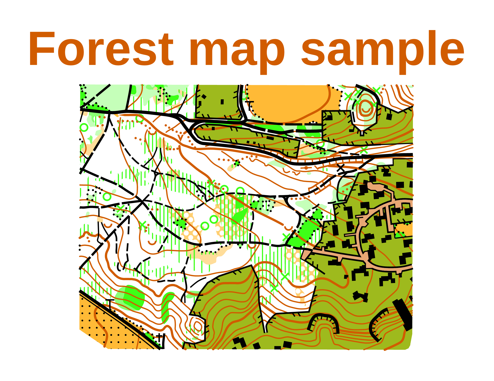
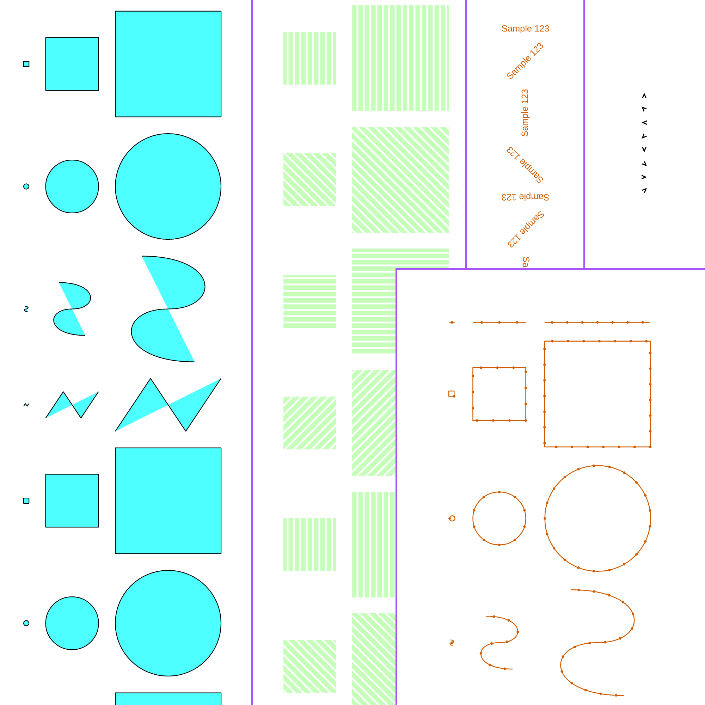
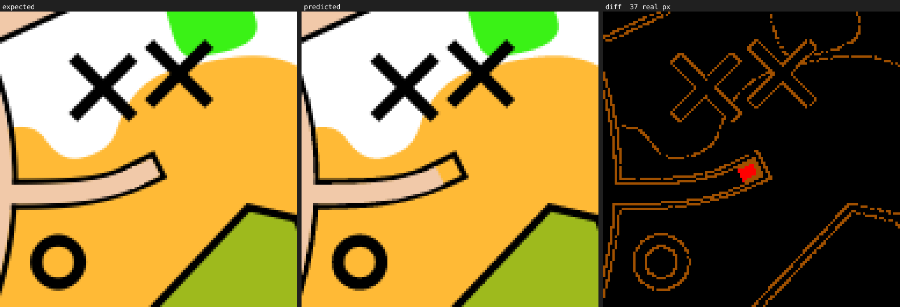

# MaUR-O

[][crate]
[](https://github.com/Noce99/MaUR-O/actions/workflows/ci.yml)

This is a **Ma**p **U**tils project written in **R**ust for **O**rienteering.


*The ground-truth renderer's output (left) side by side with MaUR-O's own rendering of the same map (right). Map: Valserena, owned by [Polisportiva Masi](https://www.polmasi.it/attivita_sportive/palestra/orienteering.it.html) and made by [Samuele Curzio](https://mapsamthing.com/en/) and [Remo Madella](https://www.remmaps.it/).*

It renders [OpenOrienteering Mapper](https://www.openorienteering.org/apps/mapper/)
`.omap`/`.xmap` files to raster images (PNG, BMP, TIFF, JPEG) from the command
line, without needing Mapper itself, Qt, or a graphical environment installed.
OCAD `.ocd` files — versions 6 through 12 and 2018 — are read too, converted
to Mapper's format on the way in, so the same tools work on either.
Alongside the renderer, it ships a small pair of benchmarking tools that build
and run suites of maps to measure how closely the renderer's output matches a
ground-truth reference — useful both for tracking rendering fidelity over time
and for spotting real regressions among the noise two rasterizers naturally
disagree on.

It also ships tools that go beyond drawing a map:

- **`contours_to_raster`** reconstructs an elevation model (a GeoTIFF) from a
  map's contour lines, and **`dem_geo_tiff_evaluator`** scores such a model
  against a ground-truth one;
- **`osm_to_omap`** turns OpenStreetMap data into a Mapper map: a base for an
  orienteering map drawn to ISSprOM 2019 or ISOM 2017-2, or a map styled like
  openstreetmap.org, optionally with bus and train lines from GTFS feeds;
- **`add_orthophoto`** downloads the aerial orthophoto of a map's ground from
  a national or regional mapping agency (about fifty open services across
  Europe) and adds it to the map as a georeferenced template.

Everything is also usable as a Rust library (`maur_o`): besides rendering, it
covers OCAD import, course layout, runnability grids and route finding,
map validation against ISOM/ISSprOM, statistics and SVG export. The crate-level
documentation (`cargo doc --open`) is the map of how those modules fit
together.

## Table of Contents

- [Installation](#installation)
  - [Fonts and fontconfig](#fonts-and-fontconfig)
- [Usage](#usage)
  - [`map_to_image`](#map_to_image)
  - [`create_benchmark`](#create_benchmark)
  - [`benchmark`](#benchmark)
  - [`contours_to_raster`](#contours_to_raster)
  - [`dem_geo_tiff_evaluator`](#dem_geo_tiff_evaluator)
  - [`osm_to_omap`](#osm_to_omap)
  - [`add_orthophoto`](#add_orthophoto)
- [Using it as a library](#using-it-as-a-library)
- [Development](#development)
- [Implementation Details](#implementation-details)
- [Known Limitations](#known-limitations)

## Installation

Dependencies:

- **A working `cargo`/Rust toolchain, version 1.88 or newer** (edition 2021).
  1.88 is the floor set by the `image` crate; everything else in the
  dependency tree asks for less.

That is all it takes to build: no C toolchain, no `pkg-config`, no `-dev`
package. Drawing *text* correctly wants one ordinary runtime library on top —
see [Fonts and fontconfig](#fonts-and-fontconfig).

CI builds and tests the crate on Linux, macOS and Windows, but rendering
fidelity has only been benchmarked on Linux so far — on macOS and Windows text
falls back to a different font resolver (see
[Fonts and fontconfig](#fonts-and-fontconfig)).

Build everything with:

```bash
cargo build --release
```

The seven executables are then in `target/release/`:

| Executable | What it does |
| --- | --- |
| [`map_to_image`](#map_to_image) | Renders one map to a PNG/BMP/TIFF/JPEG image, or to SVG. |
| [`create_benchmark`](#create_benchmark) | Builds a benchmark archive: maps plus reference images from a ground-truth renderer. |
| [`benchmark`](#benchmark) | Runs a benchmark archive and reports where MaUR-O's renderings differ. |
| [`contours_to_raster`](#contours_to_raster) | Reconstructs an elevation GeoTIFF from a map's contour lines. |
| [`dem_geo_tiff_evaluator`](#dem_geo_tiff_evaluator) | Scores a predicted elevation GeoTIFF against a ground-truth one. |
| [`osm_to_omap`](#osm_to_omap) | Converts OpenStreetMap data into a Mapper map, drawn to ISSprOM, ISOM or openstreetmap.org's look. |
| [`add_orthophoto`](#add_orthophoto) | Adds the aerial orthophoto of a map's ground to it as a template. |

Every one of them takes `--help` and `--version`.

To put them on your `PATH` instead, run `cargo install --path .` from a
checkout.

### Fonts and fontconfig

To render text correctly, MaUR-O wants a
[fontconfig](https://www.freedesktop.org/wiki/Software/fontconfig/) runtime
library — already present on essentially every desktop Linux install:

- Debian/Ubuntu: `apt install libfontconfig1`
- Fedora: `dnf install fontconfig`
- Arch Linux: `pacman -S fontconfig`

It is opened by name when the first map with text is drawn, never linked, so
it is a requirement for *correct output* rather than for building. If it is
missing, MaUR-O prints a warning once and carries on.

**That fallback matters more than it sounds.** fontconfig is what resolves a
family name the same way Qt and Mapper do. Without it the job falls to
`fontdb` alone, which picks a different font for a generic family like "Sans
Serif" — and the substituted font has different glyph widths and line
heights. So the text is not merely set in another typeface, it is drawn *in
different positions*: labels shift, and successive lines of a block drift
further apart as the line-height error accumulates. Nothing about the image
looks broken, because the geometry is untouched and only the text is wrong.

Concretely, rendering `maps/city_sample.omap` with and without fontconfig
moves **0.66% of all pixels**, at a mean error of 499 out of 765 — the scale
of black glyphs landing on white paper, not of soft edges. A benchmark run
counts every one of those as a *real* difference rather than as antialiasing
(see [Antialiasing](mds/ImplementationDetails.md#antialiasing)), so a suite
run on a machine without fontconfig reports spurious failures on every map
carrying text.

On MacOS, on Windows, and on any other platform without fontconfig, this
fallback is what runs.

## Usage

### `map_to_image`

Renders a single map to a raster image, or to an SVG drawing.

```
map_to_image [-r px-per-meter] [-f meters | -w left,top,right,bottom] <map-file> [image-file]
```

| Argument | Meaning |
| --- | --- |
| `<map-file>` | The map to render: `.omap`/`.xmap`, or an OCAD `.ocd` file. Which it is is decided by what is in the file, not by its name. |
| `[image-file]` | Where to write the image. The file suffix (`.png`, `.bmp`, `.tif`, `.jpg`, or `.svg` for vector output) selects the format; defaults to the map file's name with a `.png` suffix. |
| `-r, --resolution <N>` | Pixels per meter on the ground (default `3`). |
| `-f, --frame <N>` | Width of the white frame added on every side, in meters on the ground (default `50`). |
| `-w, --window <L,T,R,B>` | Render only this rectangle of the map, in map coordinates (mm on the paper, `y` down, as Mapper stores them), instead of the whole map. Cannot be combined with `--frame`. The image's top-left corner is the window's, so a map point's pixel is known exactly. |

This is the tool to reach for to just look at a map:

```bash
cargo build --release
./target/release/map_to_image maps/forest_sample.omap
```


*`maps/forest_sample.omap` rendered by `map_to_image`.*

To look closely at one part of a map, or to draw something over the image
at known positions, render a window instead. Here a square of 20 by 20 mm on
the paper (200 by 200 m at 1:10000), whose top-left pixel is map point
`(85, 40)`:

```bash
./target/release/map_to_image -r 10 -w 85,40,105,60 maps/forest_sample.omap closeup.png
```

A map point `(x, y)` lands at pixel `((x - left), (y - top))` times
`resolution × scale / 1000` pixels per mm — in the example above,
`10 × 10000 / 1000 = 100` pixels per mm, so the image is 2000 × 2000 pixels.

Writing to a `.svg` file instead draws the map as vector paths, sharp at any
size. `-r` has no meaning there (there are no pixels), the frame is left empty
rather than white, and `--window` is not supported — an SVG is always the
whole map:

```bash
./target/release/map_to_image maps/forest_sample.omap forest_sample.svg
```

It prints the image size, the ground size, and the map scale it read. Exit
codes: `0` success, `1` a usage error, `2` the map cannot be read, `3` its
geometry cannot be built, `4` the image cannot be saved.

### `create_benchmark`

Builds a benchmark archive: it takes a set of maps and a *ground-truth
renderer*, has that renderer draw each map, and packages both together
following the naming rules `benchmark` expects.

```
create_benchmark [OPTIONS] <renderer> <source>
```

| Option | Meaning |
| --- | --- |
| `<renderer>` | Path to the ground-truth renderer executable — [see below](#ground-truth-renderer). |
| `<source>` | Either a folder, searched recursively for `.omap`/`.xmap` files, or a single map file, which is instead split into one generated map per symbol on a grid of test objects. |
| `-o, --output <FILE>` | Archive path to write. Defaults to `benchmarks/benchmark_<source name>_<resolution>_px_m.zip`; the containing folder is created if needed. |
| `--force` | Overwrite the output archive if it already exists. |
| `-r, --resolution <N>` | Resolution of the reference images, in pixels per meter on the ground (default `3`). |
| `-f, --frame <N>` | Width of the white frame added on every side, in meters on the ground (default `50`). |
| `--filter <TEXT>` | Only include maps whose name contains this text. |

```bash
cargo build --release
./target/release/create_benchmark /path/to/ground_truth_renderer maps/ISOM_10k.omap
```

This writes `benchmarks/benchmark_ISOM_10k_3_px_m.zip`. Exit codes: `0`
success, `1` a usage or setup problem, `2` a map failed to render.


*A handful of the maps `create_benchmark` generates when `<source>` is a single map file: one per symbol, each a grid of test objects at every size and rotation that symbol needs checked.*

#### Ground-truth renderer

**This tool needs an external, ground-truth OMap renderer** — it does not
render the reference images itself, since the whole point is to compare this
project's own renderer against an independent one. Any command-line tool
that reads a map file and two options (resolution, frame) and writes an
image works; the
[`mapper_cmd_rederer`](https://github.com/Noce99/mapper_cmd_rederer) fork of
OpenOrienteering Mapper's own command line renderer, built from source, is
the one this project was benchmarked against. It is asked for its version
once (`<renderer> --version`, recorded in the archive's `info.txt`), then
invoked once per map as

```
<renderer> <map-file> <image-file> -r <px-per-meter> -f <meters>
```

which is also how `map_to_image` is called, so pointing `create_benchmark` at MaUR-O's own `map_to_image` works too — it
is a handy way to try the tooling out, though a suite built that way only
measures MaUR-O against itself.

### `benchmark`

Runs a whole benchmark suite — a zip archive of maps plus reference images —
in one pass: renders every map, compares it against its reference, and
writes a difference report.

```
benchmark [OPTIONS] <archive.zip>
```

| Option | Meaning |
| --- | --- |
| `<archive.zip>` | The benchmark archive, as produced by `create_benchmark`. |
| `--results <DIR>` | Where the run's output folder is created (default `Results`). |
| `--names-only` | Check and, if needed, correct the archive's file naming without rendering anything. |
| `--tolerance <N>` | Per-pixel difference (summed over R+G+B, 0–765) below which a pixel does not count as wrong (default `3`). |
| `--keep-antialiasing` | Report every differing pixel as real, instead of separating out ones two rasterizers can legitimately disagree about (see [Antialiasing](mds/ImplementationDetails.md#antialiasing)). |
| `--crops <N>` | How many worst-region crops to save per differing map, `0` for as many as it takes to cover every difference (default `0`). |
| `--crop-size <N>` | Side length of a cropped region, in pixels (default `128`). |
| `--zoom <N>` | Width a cropped region is enlarged to, in pixels (default `512`). |
| `--overview <N>` | Width the whole side-by-side image is scaled down to, in pixels, `0` for full size (default `2000`). |
| `--filter <TEXT>` | Only run maps whose name contains this text. |

```bash
cargo build --release
./target/release/benchmark benchmarks/benchmark_ISOM_10k_3_px_m.zip
```

Resolution and frame are not options here: they are always read back out of
the archive's own `info.txt`, written by `create_benchmark` when the archive
was made, so a run can't silently drift from the resolution and frame the
reference images were actually drawn at.

Each run gets its own timestamped folder under `Results/`, holding
`results.txt` (a table of how much each map differs, worst first),
`predictions/` (the rendered maps), and `differences/` (side-by-side images
and crops for every map with a real, non-antialiasing difference). Exit
codes: `0` success, `1` a usage or archive problem, `2` a map failed to
render.

Below are the first entries of the `results.txt` of a run produced against the
ISSprOM 2019 symbol set at 6 pixels per meter: the worst maps are reported at
the top, so this is where to look first. For what each column means, see
[Running a benchmark archive](mds/ImplementationDetails.md#running-a-benchmark-archive).

```
   real  antialiasing    wrong  largest  mean error of wrong px  map
-------  ------------  -------  -------  ----------------------  --------------------------------------------------
0.0156%       1.5679%  1.5836%       35             7.56 ± 4.15  079__area_404_Rough_open_land_with_scattered_trees
0.0148%       2.7276%  2.7424%       70            11.05 ± 7.59  076__area_402_Open_land_with_scattered_trees
0.0147%       1.9598%  1.9745%       40             7.93 ± 4.36  107__area_501.3_Paved_area_with_scattered_trees
0.0022%       0.8021%  0.8042%      765           45.77 ± 50.07  131__line_512.1_Bridge__minimum_width
0.0007%       4.4276%  4.4283%      127            17.91 ± 8.16  067__area_308_Marsh
```


*A crop from `differences/` on a real map: expected (left), predicted (middle), and the diff (right), where orange is just antialiasing — not a bug — and the red cluster is a real error, a pixel one renderer drew and the other did not.*

### `contours_to_raster`

Reconstructs the shape of the ground from a map's contour lines: works out
which way is downhill across every contour (from slope lines, closed hills,
cliffs, and a simulated "rain drop" flow where nothing else decides), assigns
each contour a height, and interpolates them into an elevation raster.

```
contours_to_raster [OPTIONS] <map-file> [output.tif]
```

| Option | Meaning |
| --- | --- |
| `<map-file>` | The map to read: `.omap`/`.xmap`, or an OCAD `.ocd` file. |
| `[output.tif]` | File name of the elevation TIFF (only the name is used; it always goes into the run folder). Defaults to the map's name with `.tif`. |
| `--results <DIR>` | Where the run's timestamped folder is created (default `Results`). |
| `--config <FILE>` | The algorithm's ~35 tunable parameters (default `config/contours_to_raster.conf`). |
| `--equidistance <M>` | Vertical distance between two adjacent contours, in meters (default `5`). |
| `--create_svg` | Also write one diagnostic SVG per stage of the algorithm, plus PNG previews of the result. |

```bash
./target/release/contours_to_raster maps/contours_to_altitude_map_1.omap --create_svg
```

Each run writes into `Results/contours_to_raster_YYYY_MM_DD__hh_mm_ss/`. The
TIFF holds single-band 32-bit float elevations in meters, relative to an
arbitrary zero (contours alone don't say how high the lowest one is); when
the map is georeferenced it is a proper GeoTIFF, resampled north-up. The
`maps/contours_to_altitude_map_*.omap` files are small test maps for it.

The algorithm, every parameter, and every diagnostic file are specified in
**[Contours-to-Raster.md](mds/Contours-to-Raster.md)**;
[Contours-to-Raster-Overview.md](mds/Contours-to-Raster-Overview.md) is a
short, implementation-free mathematical account of the same thing.

Exit codes: `0` success, `1` a usage error, `2` the map cannot be read, `3`
the config file cannot be read or parsed, `4` an output cannot be written (or
a Step 1 geometry error), `5` an unresolvable gravity conflict (Steps 2–4).

### `dem_geo_tiff_evaluator`

Scores a predicted elevation GeoTIFF — such as `contours_to_raster`'s — against
a ground-truth one. The prediction is resampled onto the ground truth's grid,
and since a DEM reconstructed from contours is only known up to an additive
constant, that constant is removed before measuring.

```
dem_geo_tiff_evaluator [--results <DIR>] <ground_truth.tif> <prediction.tif>
```

Each run writes into `Results/dem_evaluation_YYYY_MM_DD__hh_mm_ss/`:
`metrics.txt` (MSE, RMSE, MAE), `error_abs.png` and `error_signed.png` (maps
of the error), and `error_histogram.png`.

Exit codes: `0` success, `1` a usage error, `2` the ground truth cannot be
read, `3` the prediction cannot be read, `4` the two cannot be compared
(different or missing CRS, or no overlapping pixel with a value in both),
`5` an output cannot be written.

### `osm_to_omap`

Converts OpenStreetMap data into a Mapper map, drawn to an orienteering
standard or like openstreetmap.org.

```
osm_to_omap [--standard issprom|isom|osm] [--bbox min_lon,min_lat,max_lon,max_lat] <osm-file> [omap-file]
```

| `--standard` | symbol set | scale |
| --- | --- | --- |
| `issprom` (default) | ISSprOM 2019, sprint | 1:4000 |
| `isom` | ISOM 2017-2, forest | 1:10000 |
| `osm` | openstreetmap-carto (see [below](#openstreetmaporgs-look)) | by `--details` |

With `issprom` or `isom` the map holds the standard's whole symbol set,
exactly as Mapper ships it (`maps/ISSprOM_4k.omap`, `maps/ISOM_10k.omap`),
and every feature it can place drawn with it:

- buildings (521), roofs and carports as canopies (522);
- roads as paved footprints by traffic and width in ISSprOM (`501.19` for a
  primary road, `501.8` for a residential street, `501.6` for a paved
  footway), as ISOM's road lines in ISOM (502 to 507); stairways (532);
- squares, pedestrian areas, parkings and platforms as paved areas;
- water, watercourses and marshes; woods (405, or by `wood:density`), scrub,
  open land, fields, orchards and vineyards; sand and bare rock;
- walls and fences, impassable unless a `height` under 1.5 m says
  otherwise; hedges, railways, power lines, cliffs;
- residential, commercial, industrial land, allotments, cemeteries,
  farmyards and private gardens as areas that shall not be entered (520);
- towers, cairns and memorials, springs and fountains, landmark trees.

The rules start from the cross-reference tables Mapper ships for
OpenStreetMap. Where areas overlap, a smaller one is cut out of the larger
one it lies on (a wood out of a park, a park out of residential land), since
a standard's colour table would otherwise hide it. Nothing underground,
no names, no ordinary street trees. OpenStreetMap does not say how runnable
a wood is or whether a wall can be crossed, and has no contours: the map is
a base for field work, together with an orthophoto from
[`add_orthophoto`](#add_orthophoto), not a finished map. The other options
below belong to `--standard osm`; given with another standard, they are a
usage error.

```bash
osm_to_omap --bbox 11.348,44.481,11.358,44.487 bologna.osm margherita.omap
osm_to_omap --standard isom --bbox 11.33,44.47,11.37,44.50 bologna.osm colli.omap
```

#### openstreetmap.org's look

With `--standard osm` the map looks like
[openstreetmap.org](https://www.openstreetmap.org)'s Standard map at one of
the zooms 13 to 17: the symbol set (colours, road casings, path dashes, landcover, buildings,
water, railways, barriers, trees) is transcribed from
[openstreetmap-carto](https://github.com/gravitystorm/openstreetmap-carto),
one carto pixel being 0.28 mm on the paper, along with what carto shows at
that zoom and what it leaves out. Labels and POI icons are not drawn.

```
osm_to_omap --standard osm [--bbox min_lon,min_lat,max_lon,max_lat] [--details 0-4] [--bus 13,19,...] [--gtfs feed.zip [--day weekday|saturday|sunday | --date YYYYMMDD]] [--max-headway N] [--train S1,S2A,MEX,...] [--maps areas.csv [--areas-single-color]] [--drinking-water] [--legend] <osm-file> [omap-file]
```

| Option | Meaning |
| --- | --- |
| `<osm-file>` | OpenStreetMap XML, as the openstreetmap.org export, Overpass or `osmium` write it. |
| `[omap-file]` | Output map. Defaults to the input name with `.omap`. |
| `--bbox` | Only convert this area, in degrees. Without it the whole extract is converted. |
| `--details` | How much the map shows, and at which scale (default `3`, see below). |
| `--bus` | Draw these bus lines, by number (e.g. `13,19,27`): each in its own colour, its stops as circles, its number at both ends of the route. `all` draws every bus line of the GTFS feeds (or, with none, of the OSM file) that reaches the map. |
| `--bus-exclude` | Leave out these bus lines from those `--bus` selects, e.g. `--bus all --bus-exclude N1,N2,FBP`. |
| `--gtfs` | Take lines from this GTFS feed (`.zip` or unpacked folder) before the OSM file's own route relations. Repeatable: each line comes from the first feed that has it, e.g. TPER's bus network and its Marconi Express feed together. A line's own GTFS colour is kept for train lines (white, which TPER gives every bus, counts as none). |
| `--max-headway` | Leave out the bus lines that run less often than once every this many minutes between 10:00 and 16:00 (the "ogni N min" on the map), and those from a GTFS feed with no trips then at all. E.g. `--bus all --max-headway 15` keeps the frequent urban network. |
| `--day` | The kind of day the GTFS headways are counted on: `weekday` (the default), `saturday` or `sunday` (which holidays run like). The day taken is the one of that kind — a Wednesday for `weekday` — the first feed runs the most services on, from `calendar.txt`, or from `calendar_dates.txt` for a feed that lists its days one by one. GTFS lines with no trip at all that day are left out, and the legend says whose frequencies it gives (`feriali`, `il sabato`, `festivi`). |
| `--date` | The exact day (`YYYYMMDD`) the GTFS headways are counted on, instead of `--day`. |
| `--train` | Draw these train lines (also light rail, tram and monorail — e.g. `S1,S2A,MEX` for Bologna's suburban lines and the Marconi Express), from the OSM file's route relations: wider than a bus line, with larger stations, in the line's own colour where OSM gives one. |
| `--bundle-width` | The widest a bundle of lines sharing a street may be, in carto pixels (0.28 mm each; default 12). Wider, and its lines are drawn thinner. |
| `--stop-merge` | How close two stops may be on the paper, in mm, before they are drawn as one (default 3): the two sides of a street become one bar. |
| `--maps` | Draw the areas of an event's maps over everything, from a CSV table with one vertex a row: `map_id,map_number,map_name,area,vertex,latitude,longitude,stroke_color,stroke_alpha,fill_color,fill_alpha,kind` (only `map_name`, `latitude` and `longitude` are required; a map without colours is given one). Each map gets two symbols: one for its area (the outline over a tint) and one for its name. The name goes inside the area wherever it fits whole, turned along a long thin area if needed, and otherwise just beside the area, clear of the other maps and names. `kind` is `area` (the default), `forbidden` — a zone out of bounds, drawn like carto's military land: 45° hatching in its fill colour inside its outline, with no name on the map — or `start` / `finish`, a single point each, drawn as ISOM's triangle and double circle (7 mm) in the stroke colour. Forbidden zones, start and finish appear in the legend by their `map_name`. |
| `--areas-single-color` | Draw every area of `--maps` in black — opaque outlines and names, a faint black tint inside — ignoring the colours in the table; forbidden zones, start and finish in a course's overprint purple (`#a626ff`), to stand out. |
| `--drinking-water` | Mark the drinking water sources — `amenity=drinking_water` or `water_point`, and any node tagged `drinking_water=yes` (taps, springs, fountains), unless tagged `drinking_water=no` — with ISOM 2017-2's refreshment point (713), a glass in a course's overprint purple, above everything else. |
| `--legend` | Add a legend under the map (in Italian): a sample of every symbol the map actually uses with what it means, bus and train lines first with their names. |

Lines sharing a street are drawn side by side on it, like on a transit map:
every route is matched to OpenStreetMap's streets (or tracks, for trains),
the lines on each stretch laid out across it in the order of their numbers,
the band never wider than `--bundle-width`, and a stop drawn as one white
bar across the whole band. A stop of the way back on a parallel street (where
a one-way system sends the line) goes across whichever band runs there; one
on no band at all is a circle, the line's own or, shared by several lines, a
dark one. Stops closer than `--stop-merge` are one bar (or circle): beside
it, a dark arrow on each stop's side of the street points the way the buses
stopping there run, read from the direction the GTFS trip or the OSM route
relation serving it travels, and at a terminus, where buses arrive and leave
from one stop, two arrows side by side.

A line's number goes beside its terminus, and beside the line just inside
the edge where the edge of the map cuts it: in the nearest spot that covers
no line, stop, arrow or other number, up to 25 mm away (or, where there is
none, the one covering least, never another number if it can help it). Along each bus line, every 120 mm or so, is written how
often it runs — `ogni 8 min` — on average between 10:00 and 16:00: from a
GTFS feed, the trips of the direction drawn that leave their first stop in
those hours on one day (`--day`, a working day by default); from OpenStreetMap, a route's `interval` tag
where it has one. These texts turn with the line, and are moved along it
off stops, numbers and each other. A line is drawn once: the route of its main variant (the OSM relation
with the most members, or the GTFS shape most trips follow), plus the
stretches where its main variant in the other direction runs more than 30 m
away from it — the other half of a circular line, a branch, a one-way
system's parallel street — with the stops of both. For Bologna,
TPER publishes its network as GTFS on its
[open data portal](https://solweb.tper.it/web/tools/open-data/open-data.aspx)
(`gommagtfsbo` for the buses, `gtfsmex` for the Marconi Express; CC BY 3.0
IT: a map made from them has to credit TPER):

```bash
osm_to_omap --standard osm --bus all --train S1,S2A,MEX \
  --gtfs gommagtfsbo_20261006.zip --gtfs gtfsmex_20260421.zip \
  --legend bologna.osm bologna.omap
```

`--details` picks one of carto's zooms, and draws it at a round scale near
that zoom's own (at Bologna's latitude zoom 16 is about 1:6100):

| `--details` | carto zoom | scale | shows, besides the main roads and landcover |
| --- | --- | --- | --- |
| `0` | 13 | 1:24 000 | residential streets, cycleways, tracks, railways |
| `1` | 14 | 1:17 000 | buildings, footways, service roads, parking |
| `2` | 15 | 1:10 000 | building and ground outlines, squares, path halos, city walls |
| `3` | 16 | 1:5 000 | driveways and parking aisles, walls and fences, trees, platforms |
| `4` | 17 | 1:2 500 | everything wider |

Bus and train lines, stops and numbers are as large on the paper at every
level. The map is georeferenced in the UTM zone of its centre, turned so
that true north is up. The tool prints the `map_to_image -r` resolution at
which one carto pixel is one pixel of the rendering, as on
openstreetmap.org:

```bash
osm_to_omap --standard osm --bbox 11.3304,44.4848,11.3556,44.5028 bologna.osm piazza_maggiore.omap
map_to_image -r 0.7143 -f 0 piazza_maggiore.omap
```

Exit codes: `0` success, `1` a usage error (an option of `--standard osm`
given with another standard among them), `2` the OSM file or the GTFS
feed could not be read, or held nothing to convert, `4` the map could not be
written.

### `add_orthophoto`

Downloads the aerial orthophoto of the ground a map covers and adds it to
the map as a georeferenced template, behind the map and every other
template, ready to draw over in Mapper.

```
add_orthophoto [--service ID] [--pixel-size M] [--margin M] [--image FILE] <map-file> [output-map-file]
add_orthophoto --list-services
```

The photos come straight from the national and regional mapping agencies'
own WMS services. Every one listed is open (no key, no account), and was
checked by hand: a photo of a known town fetched and looked at, what it
draws outside its own ground seen, its terms read. The service is picked by
where the map is: the first in `--list-services`'s order with photos of the
whole map, so a city's own photos come before its region's, a region's
before its country's. `--service` picks one by id instead.

| Where | Services |
| --- | --- |
| Italy | Emilia-Romagna, Veneto, Friuli Venezia Giulia, Alto Adige, Trentino, Liguria, Piemonte (2010; Torino 2023), Lazio, Abruzzo, Basilicata, Puglia, Sicilia, Sardegna; everywhere else the Geoportale Nazionale's 2012/2006 photos at 50 cm |
| Germany | All sixteen Länder (10–20 cm), Berlin's 2026 true orthophoto |
| Austria | Vorarlberg, Steiermark |
| Switzerland, Liechtenstein | swisstopo SWISSIMAGE |
| Benelux | Netherlands, Flanders, Wallonia, Brussels, Luxembourg |
| France, Monaco | IGN BD ORTHO |
| Iberia | Spain (PNOA), Portugal (mainland), Andorra |
| Central and eastern Europe | Poland, Czechia, Slovakia, Republika Srpska, Albania, Cyprus |
| Nordics | Helsinki |

Why not everywhere: what's left either needs a key or an account (Denmark,
Finland and Austria nationally, Sweden's official service, the German
federal one), is closed to anyone but partner agencies (Norway), forbids
downloading its photos (Toscana), is sold (Hungary), is broken (Lombardia's
server, Umbria's certificate), or could not be found or reached. Every
server has its own address, layer names, coordinate systems, limits and
terms, and its own quirks (photos of the sea in black, or white, or both
depending on the size asked for; capabilities documents cut short), none of
which can be guessed. A new one goes in `src/orthophoto_services.rs` once it
has been checked the same way.

The map has to be a Mapper `.omap`/`.xmap`, georeferenced: placed on the
earth in a projected CRS, with the latitude and longitude Mapper keeps
beside it. The photo is asked for in the map's own CRS where the service
offers it; otherwise in Web Mercator (EPSG:3857) or latitude and longitude
(EPSG:4326), and Mapper reprojects it onto the map when it opens it. An
OCAD map has to be saved as `.omap` in Mapper first.

| Option | Default | Meaning |
| --- | --- | --- |
| `--service` | the best for the map's place | Which service to download from, by id. |
| `--list-services` | | Lists every service, best first, and exits. |
| `--pixel-size` | the service's own | The image's ground resolution, in meters. Above 300 megapixels (about 3.5 × 3.5 km at 0.2 m) a larger one is needed. |
| `--margin` | `50` | How far beyond the map's objects to download, in meters. |
| `--image` | `<map>_<service id>.jpg` | Where to write the image, beside the output map by default. Its world file (`.jgw`) goes beside it. |

The output map defaults to the input map, rewritten in place, and only its
template list and saved view change. The view is updated so the photo shows
when the map is opened, unless the map was saved with all templates hidden.
Running the tool again downloads the image again and leaves the templates
as they are. A map straddling two regions gets the one with photos of most
of it, with a warning, and black where it has none.

```bash
add_orthophoto casalecchio.omap   # writes casalecchio_it-emilia-romagna-2023.jpg + .jgw and adds the template
```

The photos belong to the agency serving them, and the tool prints who to
credit and under which terms. Many are open data (CC BY 4.0, dl-de, Etalab
and the like), but not all: most of Italy's regional photos are AGEA's, all
rights reserved, which the region is only licensed to show, and some
services state no terms at all. Check them before publishing a map drawn
over a photo.

Exit codes: `0` success, `1` a usage error, `2` the map could not be read,
`3` the map is not georeferenced (or no service covering it offers a CRS
the photo can be placed in), `4` the image or the map could not be written,
`5` no service has photos of the map's ground, `6` the service could not be
reached or answered with something other than a photo.

## Using it as a library

The crate is `maur_o`. Rendering a map takes one call:

```rust
use std::path::Path;
use maur_o::render::{render_map, save_pixmap, DEFAULT_FRAME, DEFAULT_RESOLUTION};

let drawn = render_map(Path::new("maps/forest_sample.omap"), DEFAULT_RESOLUTION, DEFAULT_FRAME)?;
println!("{} x {} m at 1:{}", drawn.ground_width, drawn.ground_height, drawn.scale_denominator);
save_pixmap(&drawn.pixmap, Path::new("forest_sample.png"))?;
```

Every public item is documented; `cargo doc --open` starts at the crate-level
overview, which explains how all the modules fit together.

## Development

```bash
cargo test --all-targets --locked                    # unit + integration tests
cargo test --doc --locked                            # doc tests
cargo fmt --all --check                              # formatting
cargo clippy --all-targets --locked -- -D warnings   # lints, warnings are errors
RUSTDOCFLAGS="-D warnings" cargo doc --no-deps --locked
```

These are exactly what CI runs (on Linux, macOS and Windows, plus a check on
the minimum supported Rust version, 1.88). See
[ImplementationDetails.md § Testing](mds/ImplementationDetails.md#testing) for
how the tests are organized.

## Implementation Details

MaUR-O reads the OpenOrienteering Mapper `.omap`/`.xmap` format and renders
it in pure Rust, with a dedicated crate for each concern (XML parsing, path
stroking and rasterization, font shaping...). An OCAD `.ocd` file is read by
converting it to that format first, following OpenOrienteering Mapper's own
importer and Purple Pen's; what such a file carries and the XML has no place
for — text on a path, a rectangle symbol's cell grid, a symbol switched off —
is reported rather than dropped silently. How closely its output matches
a ground-truth renderer, how the source is organized, and how the
benchmarking tools tell a real rendering bug from the noise two different
rasterizers' antialiasing produces, are documented in
**[ImplementationDetails.md](mds/ImplementationDetails.md)**.

All the longer documents live in [`mds/`](mds/):

| Document | What it covers |
| --- | --- |
| [ImplementationDetails.md](mds/ImplementationDetails.md) | Crate stack, source layout, benchmark archive format, antialiasing classification, testing. |
| [Contours-to-Raster.md](mds/Contours-to-Raster.md) | The full specification of `contours_to_raster`'s algorithm and parameters. |
| [Contours-to-Raster-Overview.md](mds/Contours-to-Raster-Overview.md) | A short, formal summary of the same algorithm. |
| [bug.md](mds/bug.md) | Known rendering differences against the ground-truth renderer, with pictures. |

## Known Limitations

No known bugs on the sample maps (`maps/city_sample.omap` and
`maps/forest_sample.omap`). There are a handful of minor, mostly cosmetic
differences on the ISOM/ISSprOM per-symbol benchmarks, and a few genuine
placement/shape bugs found on a private dataset of real maps — see
[bug.md](mds/bug.md) for all of them, with pictures.

<!-- Badge target. Replace with the crate link when you have it. -->
[crate]: https://crates.io/crates/maur-o
